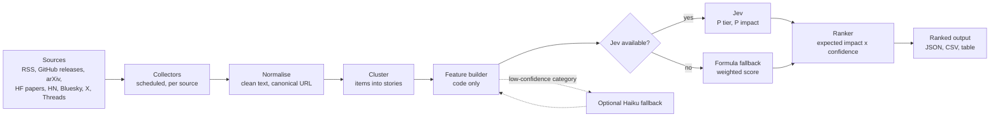

# AI Trend Signal Ranker (Jev Edition): Architecture

XMUM SDC Hackathon 2026, Domain 1. Draft, 22 Oct 2026. Supersedes the scope of [ARCHITECTURE_PLAN.md](ARCHITECTURE_PLAN.md) for the core system; that file stays as the "full app" reference.

---

## 1. Goal

**A simple, high-quality ranker, not an end-to-end app.** It collects AI and tech updates from trusted sources, merges duplicate reports, and outputs a **ranked list with scores** showing which updates are the most impactful and important.

| In scope | Out of scope (moved to "later") |
|---|---|
| Collect from official, research, community and social sources | Daily/weekly prose brief (Editor agent) |
| Merge duplicates into stories | Web UI, Telegram, RSS output |
| Code-built feature vector per story | RAG and the Ask agent |
| **Jev** decides impact and tier as probabilities | Personalisation |
| Ranked output (JSON / CSV / table) with score, probabilities and reasons | Markdown conversion of full articles |
| Deterministic formula as the fallback ranker | |

**Output, per story:** rank, title, link, sources, `P(must_know)`, `P(worth_a_look)`, `P(minor)`, expected impact (1–5), confidence, final score, and the top features that drove it.

---

## 2. Design principles

1. **Code extracts, Jev decides, code ranks.** No LLM is in the scoring path by default.
2. **Every input field is computable and auditable.** If a feature can't be explained, it doesn't go in.
3. **Probabilities, not just a number.** Confidence is shown, not hidden.
4. **Always a fallback.** If Jev is unavailable, the deterministic formula ranks with the same features.
5. **No date, no source, no entry.** Official APIs and RSS only; no scraping.
6. **Prove it on a gold set** before trusting Jev over the formula.

---

## 3. Pipeline



| Stage | Type | Notes |
|---|---|---|
| Collectors | Code | Already built and tested live: 28 sources, 537 items in one run, 0 errors |
| Normalise | Code | Strips HTML and tracking params; maps arXiv and HF paper URLs to one form |
| Cluster | Code | URL/hash match, then TF-IDF similarity plus a shared distinctive name |
| Feature builder | Code | Section 5 |
| **Jev** | Decision model (TypeSafe AI) | Structured features in, typed probabilities out |
| Formula fallback | Code | The existing score from the full plan (section 7 there) |
| Ranker | Code | Section 6 |
| Optional Haiku | LLM | Only for stories whose rule-based category is uncertain; off by default |

---

## 4. Sources (unchanged)

| Tier | Trust | Sources |
|---|---|---|
| A: official | 1.0 | Lab and company blogs (OpenAI, Google DeepMind, Google AI, Hugging Face, Microsoft Research, NVIDIA, AWS ML, GitHub Changelog, Meta Engineering), GitHub releases of key tools |
| B: research | 0.85 | arXiv (cs.AI, cs.CL, cs.LG, cs.SE), Hugging Face Daily Papers |
| C: community | 0.6 | Hacker News, Simon Willison, TechCrunch AI, The Verge AI, Bluesky |
| D: social | 0.4 | X (pay-per-use, budget-capped, off by default), Threads (needs App Review, off by default) |

Config lives in `config/sources.yaml`; adding a source needs no code change.

---

## 5. Feature vector (code only)

One flat, typed record per story. This is exactly what Jev receives.

| Group | Feature | Type | How it's computed |
|---|---|---|---|
| **Source** | `best_tier` | enum A/B/C/D | Highest-trust source in the story |
| | `authority` | float 0–1 | Trust weight of `best_tier` |
| | `has_official`, `has_research` | bool | Any Tier A / Tier B item |
| | `social_only` | bool | Every item is a social post |
| **Corroboration** | `origins` | int | Distinct sources (social accounts capped at 3) |
| | `source_families` | int | Distinct tiers present |
| **Attention** | `velocity_z` | float | Engagement per hour vs that source's 14-day median/MAD |
| | `peak_engagement` | float | Max points / upvotes / likes (normalised by followers for X) |
| **Content** | `category_rule` | enum | Rule-based category (model release, research, tool release, pricing/deprecation, security, policy, business, benchmark, product, opinion) |
| | `category_confidence` | float 0–1 | How strongly the rule matched (title match > body match > default) |
| | `release_level` | enum | major / minor / patch / pre-release / none, from the version number |
| | `is_security`, `is_breaking`, `is_pricing`, `is_howto` | bool | Keyword flags (CVE, deprecat, pricing, tutorial patterns) |
| | `model_name_hit` | bool | Matches model-name patterns (`gpt-5`, `llama 4`, `gemini 4`...) |
| | `dev_terms_hit` | int | Watchlist terms matched (`config/watchlist.yaml`) |
| **Context** | `novelty` | float 0–1 | 1 − max similarity to the last 14 days of stories |
| | `superseded` | bool | An older release of a tool that has shipped a newer one |
| | `age_hours` | float | Since first seen |

Each record is stored with the story, so every rank can be reproduced.

---

## 6. Jev decision layer

**Input:** the feature vector above.

**Outputs (typed):**
- `tier_probs`: `{must_know, worth_a_look, minor}`
- `impact_probs`: `{1, 2, 3, 4, 5}`
- `same_story_prob` (separate call, for pairs the clusterer can't decide: similarity between 0.25 and 0.6)

**Ranking:**
```
expected_impact = Σ k · P(impact = k)                (1..5)
confidence      = 1 − normalised entropy of impact_probs
final_score     = 100 × [0.6 · P(must_know) + 0.3 · P(worth_a_look)] × (0.5 + 0.5 · confidence)
```
- Tier = argmax of `tier_probs`, with the existing guardrails kept as hard rules: social-only stories can't be Must-know, superseded releases are Minor, and Must-know is capped at 5 per day.
- Every Jev output is stored with `jev_version` and the raw distributions.

**Fallback:** if Jev errors, times out (> 2 s), or is unconfigured, the deterministic formula scores the story and the output row is marked `ranked_by: formula`.

**Open questions (need Jev's docs):** API shape (REST or SDK), pricing, latency, whether it needs labelled examples or training, and calibration guarantees.

---

## 7. Optional Haiku fallback

Off by default. When `category_confidence < 0.5`, send the story's title and lead (≤ 3000 chars) to Claude Haiku 5.5 for category and flags only. The result replaces the rule output in the feature vector; Jev still makes the decision. The evidence-quote check from the full plan still applies. Expected cost: a few cents a day.

---

## 8. Output

```json
{
  "generated_at": "2026-10-22T08:00:00+08:00",
  "ranked_by": "jev",
  "stories": [
    {
      "rank": 1,
      "title": "Example: Lab X releases Model Y",
      "url": "https://example.com/post",
      "sources": ["OpenAI News", "Hacker News"],
      "tier": "must_know",
      "tier_probs": {"must_know": 0.72, "worth_a_look": 0.23, "minor": 0.05},
      "expected_impact": 4.3,
      "confidence": 0.81,
      "final_score": 78.4,
      "top_features": ["official source", "2 independent reports", "trending 3.1σ on HN", "model-name match"]
    }
  ]
}
```
Also written as CSV and printed as a table by `python -m trendsignal rank`. A skill-momentum JSON stays available for SKidea's matching.

---

## 9. Evaluation

| Check | Method | Target |
|---|---|---|
| Gold set | About 150 stories from the last 30 days, hand-labelled into tiers and impact by 2 people | — |
| Ranking quality | Precision@5 for Must-know; NDCG@10 | Jev ≥ formula |
| Calibration | Reliability of `P(must_know)` vs labels | Well calibrated |
| Known-event recall | 10 agreed major events from the last 30 days reach Must-know | ≥ 9 of 10 |
| Clustering | 50 sampled stories, wrong merges/splits | < 5% |
| Cost and latency | Per run | Within budget |

**Promotion rule:** Jev ranks by default only if it beats the formula on the gold set without regressing any source type. Until then it runs as a second opinion and the formula ranks.

---

## 10. What changes from the current code

| Keep | Change | Remove from the core path |
|---|---|---|
| Collectors, runner, circuit breaker | `pipeline/heuristics.py` exposes `category_confidence` | Editor agent and claim verifier |
| Normalise, cluster, similarity | New `pipeline/features.py` builds the vector | Template brief, web app |
| Score formula (as fallback) and tier guardrails | New `decision/jev.py` client with timeout and fallback | Enricher as a required step |
| SQLite storage | New `rank` CLI command and JSON/CSV writer | |

---

## 11. Build plan

| When | Deliverable |
|---|---|
| Wed 22 Oct | `features.py` and tests; output writer; formula-ranked output end to end |
| Thu 23 Oct | Jev client (once docs are in hand) with fallback; start the gold set |
| Fri 24 Oct (freeze midday) | Gold-set comparison Jev vs formula; pick the default; deploy on Replit with the scheduler |
| Sat 25 Oct, before 07:59 | README with metrics, demo video, Tech Declaration (name Jev and any Claude use) |

---

## 12. Risks

| Risk | Fallback |
|---|---|
| Jev's API, cost or training needs are unknown | Formula ranks; Jev added behind a flag |
| Jev needs labelled data | The gold set doubles as training examples |
| Rule-based categories are wrong on some stories | `category_confidence` + optional Haiku fallback |
| A source goes down | Circuit breaker, stale flag, last good data |
| Hackathon requires naming AI models | Declare Jev (and Haiku if enabled) in the Tech Declaration |
