# AI Trend Signal Layer: Architecture Plan

XMUM SDC Hackathon 2026, Domain 1. Draft, 22 Oct 2026. Preliminary deadline: **25 Oct, 07:59 AM MYT**.
Related: [SKidea.md](../SKidea.md) (this is its "AI advancement tracker"), [Skill Forecast System Design](../SDC_Domain1_Skill_Forecast_System_Design.md).

---

## 1. What we are building

**One-liner:** an agent that reads official AI and tech sources plus social media every few hours, merges duplicate reports of the same news, scores each story for importance, and gives CS students and developers a short daily brief: *the 3 to 5 things worth your time today, and what you can safely skip.*

**Target user:** CS students, fresh grads, and working developers. They have little time and they get too much news.

**The promise, made concrete:**

| User question | What the system answers |
|---|---|
| "What happened in AI and tech that actually matters?" | A ranked feed in three tiers: **Must-know**, **Worth a look**, **Minor / FYI** (collapsed) |
| "Is it worth my time?" | Each story gets a 2-line TL;DR, **why it matters to a developer**, and a **time-to-understand** estimate |
| "Can I trust it?" | Every story links to its primary source and shows *why it ranked there* (a score breakdown) |
| "What's only rumour so far?" | Social-only stories go to a separate **Emerging / unconfirmed** lane and never reach Must-know |
| "What's trending this week?" | A weekly recap of rising topics (counts, plus how they changed against last week) |

**Out of scope for the MVP:** full personalisation, mobile apps, non-English sources, paywalled media.

---

## 2. Design principles

1. **LLMs handle language. Code handles numbers.** LLMs classify, extract, and summarise. The importance score comes from a deterministic formula that is testable and repeatable. (This is the same rule as the Skill Forecast design.)
2. **No date, no source, no entry.** Every record carries `source_id`, `url`, `published_at`, `retrieved_at`. This also meets the brief's "updatable, dated source" requirement.
3. **Official sources confirm; social sources warn early.** Social media measures attention and speed. It is not proof.
4. **Official APIs and RSS only. No scraping.** X and Threads go through their official APIs, or we don't use them.
5. **Explain every rank.** If we can't say why a story is #1, it shouldn't be #1.
6. **Fail soft.** If a source goes down, show it as "stale" and keep serving the last good data. If the LLM fails, fall back to the source's own title and summary.

---

## 3. End-to-end architecture

```mermaid
flowchart LR
    subgraph S[Sources]
      A1[Official: lab blogs RSS,<br/>changelogs, GitHub releases]
      A2[Research: arXiv,<br/>Hugging Face papers & trending]
      A3[Community: Hacker News,<br/>Bluesky, newsletters RSS]
      A4[Social: X API,<br/>Threads API]
    end

    SCH[Scheduler<br/>per-source cadence] --> COL
    S --> COL[Collectors<br/>one adapter per source]
    COL --> RAW[(Raw store<br/>immutable, dated)]
    RAW --> NORM[Normalise<br/>clean text, canonical URL]
    NORM --> DEDUP[Dedupe + cluster<br/>items into Stories]
    DEDUP --> ENR[Enrich: LLM batch<br/>category, entities, TL;DR]
    ENR --> VER1[Validator<br/>schema + quote check]
    VER1 --> SCORE[Score engine<br/>deterministic formula]
    SCORE --> RANK[Rank + tier<br/>Must-know / Worth a look / Minor]
    RANK --> DB[(Stories DB)]
    DB --> ED[Editor agent<br/>writes daily/weekly brief]
    ED --> VER2[Claim verifier<br/>code gate]
    VER2 --> OUT[Delivery: web feed,<br/>email / Telegram, RSS, JSON API]
    OUT --> FB[User feedback<br/>useful / not / already knew]
    FB --> CAL[Weight calibration<br/>offline, weekly]
    CAL --> SCORE
    DB --> SK[SKidea skill scoring<br/>topic momentum per skill]
```



The system is mostly a **scheduled pipeline**, not a free-roaming agent. Only three places use an LLM. Section 8 explains why.

| # | Stage | Type | Runs |
|---|---|---|---|
| 1 | Scheduler | Code | Always on (cron) |
| 2 | Collectors | Code | Per-source cadence (section 5) |
| 3 | Normalise | Code | After each collect |
| 4 | Dedupe + cluster | Code + embeddings | After each collect |
| 5 | Enrich | **LLM batch function** (small, fast model) | New stories only |
| 6 | Score + rank | Code | After enrich, and hourly (to apply freshness decay) |
| 7 | Editor | **LLM agent** (stronger model) | Daily 08:00 MYT, weekly on Monday |
| 8 | Claim verifier | Code | Before anything is published |
| 9 | Ask (stretch) | **LLM agent** with read-only tools | On user request |

---

## 4. Sources

### 4.1 Source tiers

Each source has a **trust weight**, used as the Authority feature in the score.

| Tier | Trust | Examples | Role |
|---|---|---|---|
| **A: Primary / official** | 1.0 | OpenAI, Anthropic, Google DeepMind, Meta AI, Microsoft, NVIDIA, Mistral, and Hugging Face blogs (RSS) · GitHub **releases** of key repos (PyTorch, Transformers, vLLM, LangChain, Next.js, Python, Kubernetes…) · cloud release notes (AWS, GCP, Azure) | Confirms that something happened |
| **B: Research** | 0.85 | arXiv API (cs.AI, cs.CL, cs.LG, cs.SE) · Hugging Face Daily Papers and trending models | Early capability signal |
| **C: Curated community** | 0.6 | Hacker News (Algolia API) · Bluesky (open API) · named engineers' blogs and newsletters via RSS | Shows what practitioners care about |
| **D: Social** | 0.4 | X (curated list of about 50 accounts: lab leads, maintainers, researchers) · Threads (curated accounts and keyword search) | Earliest warning, attention velocity |

Every source lives in one config file (`sources.yaml`), so adding a source never needs a code change:

```yaml
- id: anthropic_news
  tier: A
  adapter: rss
  url: https://www.anthropic.com/news/rss.xml   # verify the exact feed URL
  poll_every: 1h
  terms_note: "public RSS"
- id: x_curated
  tier: D
  adapter: x_api
  accounts_file: config/x_accounts.txt
  poll_every: 3h
  daily_budget_usd: 1.50
```

### 4.2 X and Threads: what's actually possible (checked 22 Oct 2026)

| Platform | Access | Cost and limits | Plan |
|---|---|---|---|
| **X** | Official API, now **pay-per-use** (the default since early 2026; the free tier is effectively gone) | Reported at about **$0.005 per post read** and $0.01 per user lookup. Search is reportedly priced higher, so verify on docs.x.com | **Curated timelines, not broad search.** 50 accounts × about 5 posts a day ≈ 250 reads ≈ **$1.25/day**. A hard daily budget guard stops collection at the cap. Optional for the MVP |
| **Threads** | Official Threads API. Keyword search needs the **`threads_keyword_search`** permission (App Review). Without it, search only returns your own posts | 2,200 queries per user per rolling 24 h. Author-username filter added Jan 2026. Sensitive keywords return empty | **Apply for App Review now.** Ship the adapter behind a feature flag and treat Threads as v2 unless approval arrives |

Social posts are used for two things only: (1) **attention velocity** on an existing story, and (2) **early warning**: a new story that is unconfirmed until a Tier A or B source matches it.

---

## 5. Scheduling: "auto-search daily or weekly"

Different sources move at different speeds, so each one gets its own cadence:

| What | Cadence | Why |
|---|---|---|
| Tier A RSS and GitHub releases | Every 1 h | Cheap. Uses conditional GET (`ETag` / `If-Modified-Since`) so unchanged feeds cost nothing |
| Hacker News, Bluesky | Every 1 h | Free APIs; engagement changes fast |
| X curated timelines | Every 3 h | Paid, so it is budget-guarded |
| arXiv, Hugging Face papers | Daily, 06:00 MYT | arXiv publishes in daily batches |
| Re-score (freshness decay, new engagement) | Every 1 h | Ranks change as stories age or spread |
| **Daily brief** | **08:00 MYT** | |
| **Weekly recap** | **Monday 08:00 MYT** | |
| Weight calibration | Weekly (offline) | Uses feedback plus the gold set |

**Where it runs:** Replit Scheduled Deployments (Replit is compulsory for the hackathon). GitHub Actions cron is the fallback.

**Reliability rules:**
- Runs are **idempotent**. Upserts key on `(source_id, external_id)`, so a rerun never duplicates.
- Each source has a **circuit breaker**: after 3 failures it is marked `stale`, and the UI shows "last updated X h ago".
- A `runs` table logs every job: started, finished, items fetched, errors, cost.

---

## 6. Data model

```
Source     (id, tier, adapter, trust_weight, poll_every, last_ok_at, status)
RawItem    (id, source_id, external_id, url, payload_json, published_at, retrieved_at)   -- immutable
Item       (id, raw_item_id, canonical_url, title, text, author, published_at,
            engagement_json, content_hash, embedding)
Story      (id, title, anchor_item_id, first_seen_at, last_updated_at,
            category, entities[], tldr, why_it_matters, audience[],
            time_to_understand_min, status: confirmed|unconfirmed)
StoryItem  (story_id, item_id)                     -- many reports → one story
Score      (story_id, computed_at, total, tier, features_json, weights_version)
Digest     (id, kind: daily|weekly, date, story_ids[], body_md, model, verified_at)
Feedback   (id, story_id, user_id, signal: useful|not_important|already_knew|wrong, at)
Run        (id, job, started_at, finished_at, items, errors, cost_usd)
```

A **Story** is the unit users see. One model launch might appear as 1 official blog post, 1 GitHub release, 40 X posts, and 1 HN thread. All of them collapse into **one** story whose anchor is the official post.

---

## 7. The ranking engine (the core)

### 7.1 Step 1: Dedupe and cluster

1. **Exact:** canonical URL (strip UTM tags, resolve redirects) plus a content hash.
2. **Near-duplicate:** embedding cosine similarity ≥ 0.85 **and** at least one shared entity (e.g. the same model name), within a 72 h window.
3. The highest-tier item becomes the story's **anchor**. If the anchor is Tier D only, the story is `unconfirmed`.

Embeddings: a small CPU model (e.g. `bge-small-en`) runs fine on Replit, with no API cost.

### 7.2 Step 2: Enrich (LLM, structured output)

For each **new** story, the small model returns JSON matching a strict schema:

```json
{
  "category": "model_release | research | product_feature | dev_tool_release | api_pricing_change | security_incident | policy_regulation | funding_business | benchmark | opinion",
  "entities": [{"name": "Llama 5", "type": "model"}, {"name": "Meta", "type": "org"}],
  "change_magnitude": 1,
  "magnitude_reason": "…",
  "audience": ["ml_engineer", "backend", "frontend", "data", "devops", "student"],
  "is_breaking_change": false,
  "tldr": "max 2 sentences",
  "why_it_matters": "1 sentence, for a developer",
  "evidence_quotes": ["exact quote from the source text"]
}
```

`change_magnitude` uses an **anchored rubric** so that scores stay consistent from day to day:

| Level | Meaning | Example |
|---|---|---|
| 5 | Changes how many developers work | A new frontier model; a major platform shift; a critical CVE in a ubiquitous library |
| 4 | Big change to a widely used tool | A major framework version; an API pricing or deprecation change; a SOTA paper with code |
| 3 | Notable feature | A new API capability; a significant library release |
| 2 | Minor update | A point release; a small feature |
| 1 | Noise | Opinion, rumour, patch notes, marketing |

**The validator (code)** rejects the output if the schema fails or if any `evidence_quote` doesn't appear in the source text. In that case it retries once, then falls back to the source title with `magnitude = 2`. Source text goes in as **data inside delimiters**, never as instructions, which defends against prompt injection hidden in posts.

### 7.3 Step 3: Score (deterministic)

Every feature is normalised to the range 0 to 1:

| Feature | Weight | How it's computed |
|---|---|---|
| **Impact** | 0.25 | `change_magnitude / 5` from the rubric |
| **Authority** | 0.20 | Highest trust weight among the story's sources |
| **Corroboration** | 0.20 | `1 − e^(−0.5 · n)`, where n = independent sources (distinct domains, counted once per source family) |
| **Velocity** | 0.15 | Engagement growth per hour, as a **robust z-score** (median/MAD) against that source's own baseline, then a sigmoid. X likes are normalised by follower count, so big accounts don't dominate |
| **Dev relevance** | 0.10 | Share of entities on the "developer-facing" watchlist (popular libraries, APIs, languages) plus `is_breaking_change` |
| **Novelty** | 0.10 | `1 − max similarity` to stories from the past 14 days (penalises rehashes) |

```
base      = Σ weight_i × feature_i
freshness = e^(−age_hours / τ)          τ = 36 h for the daily feed, 120 h for the weekly
penalty   = 0.15 if unconfirmed (social-only) + 0.10 if opinion/marketing
score     = 100 × max(0, base × freshness − penalty)
```

The weights are a starting point. Section 10 says how we tune them.

### 7.4 Step 4: Tier

| Tier | Rule |
|---|---|
| 🔴 **Must-know** | score ≥ 75 **and** confirmed (has a Tier A or B source, or ≥ 3 independent sources). **Capped at 5 per day.** Overflow drops to "Worth a look" |
| 🟠 **Worth a look** | 50 to 74 |
| ⚪ **Minor / FYI** | < 50. Collapsed by default as a one-line list |
| 🟡 **Emerging / unconfirmed** | Social-only, with high velocity. A separate lane, labelled "not yet confirmed" |

The daily cap is deliberate. If everything is important, nothing is. The cap keeps "Must-know" meaningful.

### 7.5 Explainability

Every story card shows a breakdown, for example: *"Ranked #1: official source (Anthropic) · 7 independent reports · impact 5/5 (new model) · trending 3.1σ above normal on HN."* This is generated from `features_json`, not by the LLM.

---

## 8. Agents: what is an agent and what isn't

Only the steps that need judgement over language use an LLM. Everything else is code, because code is cheap, testable, and can't hallucinate.

| Component | Kind | Model (declare in the Tech Declaration) | Guardrails |
|---|---|---|---|
| **Enricher** | LLM batch function, not an agent | Claude Haiku 5.5 (`claude-haiku-5-5`): cheap and fast. Use the Batch API and prompt caching on the fixed rubric | Strict JSON schema · quote check · fallback |
| **Editor** | Agent with read-only tools: `get_top_stories(date)`, `get_story(id)`, `get_trend_counts(week)` | Claude Sonnet 5.5 (`claude-sonnet-5-5`) | It may only **reorder words, not ranks**: the order comes from the score. Every sentence must cite a `story_id` |
| **Claim verifier** | Code gate | — | Each cited `story_id` exists and is in today's set · every number in the text matches a stored value · no uncited URLs. Failed sentences are stripped; if more than 30% fail, a **template brief** is generated from the DB instead |
| **Ask** (stretch) | Agent with read-only tools: `search_stories`, `get_story` | Sonnet 5.5 | Same verifier. Answers "what happened with X this week?" |
| **Source scout** (v2) | Agent, weekly | Sonnet 5.5 | *Proposes* new feeds or accounts that keep showing up as corroborators. **A human approves** every addition to `sources.yaml` |

**Fallback chain for the brief:** Editor agent → template brief built from the DB → plain ranked list. The demo never dies on an LLM error.

---

## 9. What the user sees

**Daily brief (web, plus email / Telegram):**

```
🔴 MUST-KNOW — Thu 22 Oct
1. [Model release] Lab X ships Model Y with 1M context        ⏱ 8 min to understand
   TL;DR: …   Why it matters to you: …
   Why #1: official · 7 reports · impact 5/5 · trending 3.1σ   → Read the official post
2. …
🟠 WORTH A LOOK (6)          ⚪ MINOR (23, collapsed)          🟡 EMERGING (2, unconfirmed)
```

- **Time to understand** = a reading-time estimate from the anchor's length and type (blog post ≈ 5 to 10 min, paper ≈ 30 to 60 min), plus a "2-minute version" (the TL;DR).
- **Filters:** by category, and by audience (backend, ML, frontend…).
- **Feedback buttons:** 👍 useful · 👎 not important · "already knew" · "wrong". These feed calibration.
- **Weekly recap:** the top 10 stories of the week, plus **rising topics** (entity mention counts this week against the 4-week average).
- **Outputs for other systems:** an RSS feed and a JSON API (`/api/stories?tier=must_know&since=…`).

**SKidea integration:** story entities are mapped to skills (e.g. "vLLM release" → *LLM serving*). Weekly counts per skill become the **adoption momentum** input to SKidea's skill-scoring engine. This is the brief's "trend-signal layer feeding the matching, live" demo.

---

## 10. How we know the ranking is good (evaluation)

| Check | Method | MVP target |
|---|---|---|
| **Gold set** | Hand-label about 150 stories from the past 30 days into tiers (2 team members label independently; disagreements are resolved and logged) | Must-know **precision@5 ≥ 0.8** |
| **Recall of known big events** | List 10 events everyone agrees were major (big model launches, major CVEs). Replay the past 30 days of data. Did each one reach Must-know within 24 h? | ≥ 9 of 10 |
| **Dedupe quality** | Sample 50 stories and count wrongly merged or split ones | < 5% errors |
| **Freshness** | Median delay from an official `published_at` to appearing in the feed | < 2 h |
| **Enricher accuracy** | Category and magnitude against the gold set; quote-check pass rate | ≥ 85% category agreement |
| **Cost** | `runs.cost_usd` per day (LLM + X API) | < $3/day |
| **User signal** | Share of "useful" vs "not important" on Must-know items | Tracked; used to tune weights |

**Tuning the weights:** grid search over the weights against the gold set (maximise NDCG@10), then freeze them as `weights_version = v2`. Every score records which version produced it.

---

## 11. Tech stack

| Layer | Choice | Why |
|---|---|---|
| Language | Python 3.12 | Best libraries for feeds, embeddings, and the LLM SDK |
| API + jobs | FastAPI + APScheduler (or Replit Scheduled Deployments) | Simple; one repo |
| DB | SQLite + `sqlite-vec` for the MVP → Postgres + `pgvector` later | Zero setup for the hackathon, with a clear upgrade path |
| Feeds / HTTP | `feedparser`, `httpx` (async, with retries and backoff) | |
| Embeddings | `sentence-transformers` with `bge-small-en` on CPU | Free and runs locally |
| LLM | Anthropic SDK: Haiku 5.5 for enrichment, Sonnet 5.5 for the editor | Structured outputs, Batch API, prompt caching |
| Frontend | Next.js or plain HTML + HTMX | Pick whichever the team is fastest in |
| Delivery | Email (Resend / SMTP) or a Telegram bot | Telegram is the fastest to build |
| Hosting | **Replit** (compulsory) | |
| Secrets | Replit Secrets / `.env` (never committed) | The repo must have no secrets |

**Repo layout:**

```
ai-trend-signal/
  config/            sources.yaml, x_accounts.txt, weights.yaml, watchlist.yaml
  collectors/        base.py, rss.py, github_releases.py, arxiv.py, hf.py, hn.py, x_api.py, threads.py
  pipeline/          normalise.py, cluster.py, enrich.py, validate.py, score.py, tier.py
  agents/            editor.py, verifier.py, ask.py
  api/               main.py (FastAPI), routes/
  web/               UI
  eval/              gold_set.csv, replay.py, metrics.py
  tests/
  LICENSE            Apache 2.0 (the hackathon requires it)
```

---

## 12. Security, privacy, and compliance

- **Terms:** official APIs and RSS only. No scraping of X, Threads, LinkedIn, or JobStreet.
- **Personal data:** store public posts from a **curated list of public figures** only. Keep only the handle, the post URL, and engagement counts, not follower lists or profiles. Honour deletions: if a post 404s, drop its text.
- **Prompt injection:** source text is untrusted. It goes in as delimited data; the enricher has no tools; outputs are schema-validated.
- **Cost guard:** a daily USD cap per paid source and for LLM spend. Collection stops at the cap and logs it.
- **Secrets:** environment variables only, checked at startup.
- **Attribution:** every story links to its sources; arXiv and other licences are noted in the Tech Declaration.

---

## 13. Build plan (to the 25 Oct deadline)

| When | Deliverable |
|---|---|
| **Wed 22 Oct (today)** | Repo + Apache 2.0 licence · `sources.yaml` with about 15 Tier A/B/C sources · RSS, GitHub releases, and HN collectors · raw store · **apply for Threads App Review and decide on X** |
| **Thu 23 Oct** | Normalise, dedupe, and clustering · enricher with schema validation · score + tier · start the gold set (backfill the past 30 days) |
| **Fri 24 Oct (feature freeze midday)** | Web feed with tiers and score breakdowns · daily brief via the Editor + verifier (template fallback) · deploy on Replit with schedules · feed entity counts to SKidea |
| **Sat 25 Oct, before 07:59** | Gold-set metrics in the README · demo video · Tech Declaration (models, APIs, access tiers) |
| **Finals (28 Oct to 1 Nov)** | X adapter (if approved) · Threads (if approved) · weekly recap · feedback-driven weight tuning · Ask agent |

**MVP sources (free, reliable):** about 10 lab and company RSS feeds, about 15 GitHub repos' releases, arXiv, Hugging Face Daily Papers, and Hacker News. That's enough for a convincing live demo even if X and Threads never come through.

---

## 14. Risks and fallbacks

| Risk | Fallback |
|---|---|
| The X cost is too high, or search pricing is unclear | Drop X, or limit it to curated timelines with a daily budget cap. HN and Bluesky cover community velocity |
| Threads App Review isn't approved in time | Ship it behind a flag, labelled "pending approval" in the Tech Declaration |
| An RSS feed URL changes or a source goes down | Circuit breaker, "stale" badge, keep the last good data |
| Bad clustering merges two different stories | A shared-entity requirement on top of embedding similarity; a manual split button in the admin view |
| The LLM over-rates hype | The anchored rubric; Impact is only 25% of the score; social-only stories can't reach Must-know |
| A quiet news day, with nothing above 75 | Show "No must-know items today", which is honest and builds trust. Don't lower the bar |
| Demo-day network failure | A cached, dated snapshot of the last run, with a "last updated" stamp |

---

## 15. Decisions needed from the team

1. **X:** pay about $1 to $2 a day for curated timelines, or drop X for the MVP?
2. **Threads:** who submits the App Review today?
3. **Delivery channel:** web only, or web plus Telegram or email?
4. **Frontend:** Next.js or HTMX?
5. **Gold set:** which two people label the 150 stories?
