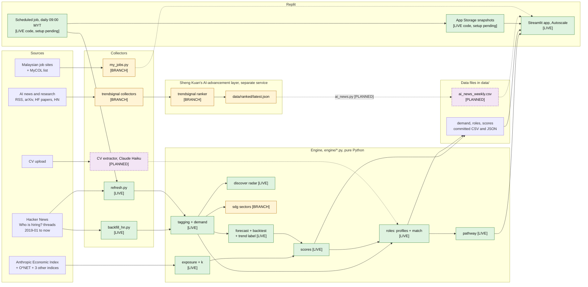
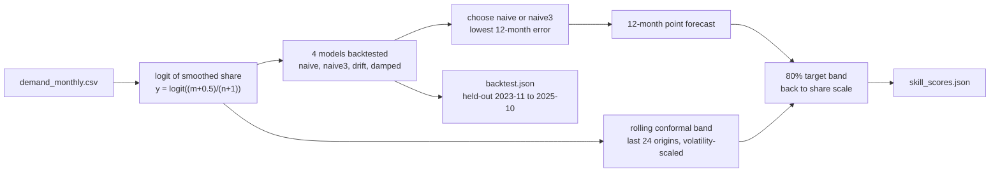
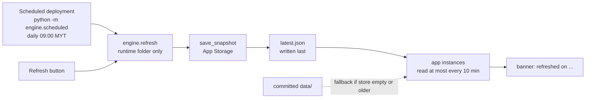
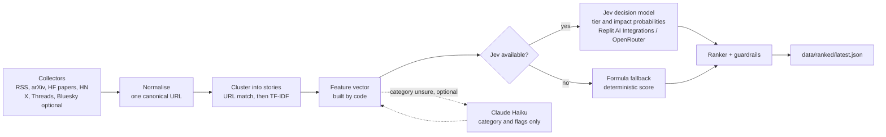
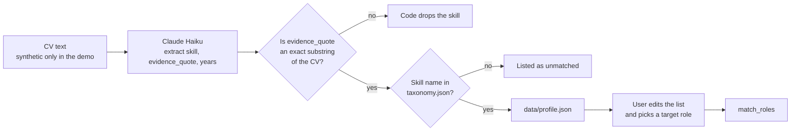
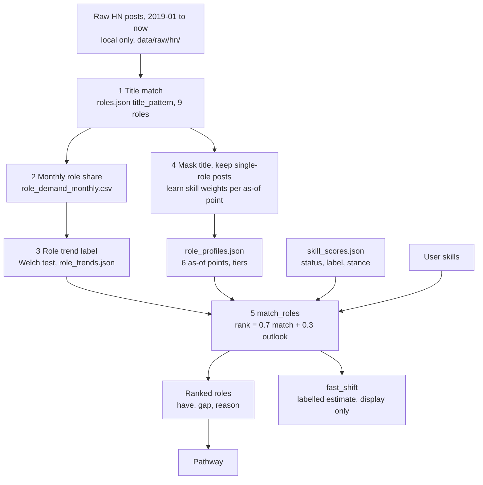
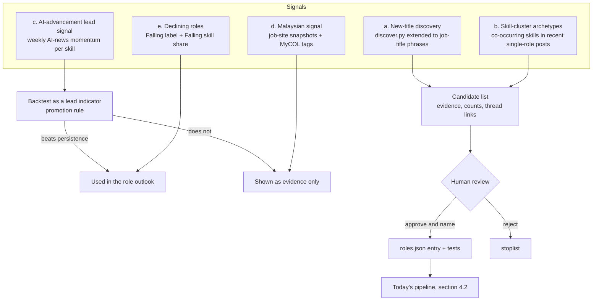

# Verity: architecture

Team Hokkien Mee Is Purple (Ee Zhan, Sheng Kuan). XMUM SDC Hackathon 2026, Domain 1.
Written 23 Oct 2026 on branch `docs/architecture`. The status table in `docs/build-plan.md` is the source of truth for what is built.

## How to read this document

Every component has one status tag.

| Tag | Meaning |
|---|---|
| **[LIVE]** | Built and merged in `main`. |
| **[BRANCH]** | Built on an unmerged branch or package. Not in `main`. |
| **[PLANNED]** | Not built. A design only. |

A planned part never appears as a working part. Every number comes from a file. The file is in brackets, for example (data/backtest.json). When a number has no file, it is left out.

---

## 1. Purpose and the user

Verity helps a junior or mid-level tech developer in Malaysia plan a career move. The user is, for example, "Aina, a junior Python developer" (a synthetic persona in `app.py`). Verity shows which skills are rising or falling in dated public job data. It ranks future roles by how well the user's skills match them. It then turns the skill gap into an ordered plan with daily tasks. Every number shows its source and date, and the user makes the decision. Tech roles are the starting group, because they have the best free, dated, public data.

### Design principles

1. **Code computes every number.** A language model never produces a score, a rank, a forecast or a date.
2. **LLMs only extract or word things.** An LLM may read a CV or write a sentence. Code checks what it returns.
3. **Every number has a source and a date.** The app shows both.
4. **Tested before trusted.** A method enters the product only if a backtest on held-out data supports it. The simple method won the forecast test, so it ships (data/backtest.json).
5. **The human decides.** Verity shows estimates and labels them. New skills and new roles need a person to approve them.
6. **Public or synthetic data only.** No scraping behind a login or a bot challenge. No real CVs in the demo.

---

## 2. System overview

Solid arrows work today. Dotted arrows are branch or planned links.

The shape of the system:

- **The engine is plain Python.** It reads files in `data/` and writes files in `data/`. It has no server and no database.
- **The app reads files.** `app.py` (Streamlit, five tabs: Roles, Pathway, Skills, Skill detail, Method) calls the engine and reads its output files. The sidebar has a Moderate or Fast scenario switch, an As-of month slider and a Refresh button.
- **Sheng Kuan's AI-advancement layer is a separate package.** It runs on its own and writes one ranked file. It is not connected to the app yet. The planned link is a file, not a function call (section 3.17).
- **Collectors write counts, not text.** Raw post text stays in the gitignored folder `data/raw/`. Only aggregates and thread links are committed.

---

## 3. Components

### 3.1 Skill taxonomy and tagger [LIVE]

- **What it does.** Finds which of the 40 tech skills a job post mentions.
- **Inputs.** `data/taxonomy.json` (40 skills; each has `skill`, `category`, `synonyms`, `pattern`, `case_sensitive`, `sdg`, `sdg_reason`). Post text, as HTML.
- **Outputs.** A set of canonical skill names per post.
- **Key functions.** `engine/tagging.py`: `load_taxonomy`, `clean_text`, `tag_text(text, taxonomy)`.
- **Why built this way.** Regular expressions give the same result on every run. They cost nothing and a judge can read them. Counting rules are plain: a post that says "PostgreSQL" counts as PostgreSQL only, not as SQL. "React Native" is not React. A bare "AI" in a company blurb is not a skill, so Machine Learning needs real skill words (docs/build-plan.md, P1). "JavaScript / TypeScript" is one combined row, and TypeScript also keeps its own row.
- **How tested.** `tests/test_tagging.py` covers the hard names, for example Go, R, C, C++, C#, Swift.
- **Status.** [LIVE]

### 3.2 Hacker News backfill and live refresh [LIVE]

- **What it does.** Downloads every monthly "Ask HN: Who is hiring?" thread from Jan 2019. Updates the current month on demand.
- **Inputs.** The public Algolia HN API. One request at a time, with pauses and retries.
- **Outputs.** `data/hn_threads.csv`: 94 threads, 48,508 top-level posts, Jan 2019 to Oct 2026 (data/hn_threads.csv). Raw JSON goes to `data/raw/hn/` (local only).
- **Key functions.** `engine/backfill_hn.py`: `list_threads`, `fetch_latest_thread`, `upsert_thread_row`. `engine/refresh.py`: `refresh(work_dir)`.
- **Why built this way.** The source is free, dated, monthly and tech-specific. Each thread has a URL to cite. `refresh()` never writes into the committed `data/` folder. It copies the files to a runtime folder, fetches the newest thread, recomputes only that month, and rebuilds the scores there. If the network fails, it keeps the last good data and returns an error dict instead of raising.
- **How tested.** `tests/test_refresh.py`, `tests/test_demand.py`.
- **Limit.** The source is US- and startup-heavy (docs/build-plan.md, risks).
- **Status.** [LIVE]. The Refresh button is in the app sidebar.

### 3.3 Demand series and AI-context series [LIVE]

- **What it does.** For each skill and month, computes the share of posts that mention the skill. A second series holds the share of posts that mention AI at all.
- **Inputs.** `data/hn_threads.csv`, raw posts, `data/taxonomy.json`.
- **Outputs.** `data/demand_monthly.csv` (month, skill, mentions, n_posts, share, share_smooth, thread_id, thread_url). `data/ai_context_monthly.csv`, which runs from 6.4% in 2019-01 to 54.6% in 2026-09 (data/ai_context_monthly.csv).
- **Key functions.** `engine/demand.py`: `build_demand`, `build_all`, `update_months`.
- **Why built this way.** Share, not count: posts per month fell over the years, so raw counts would make every skill look like it is dying. A post counts once per skill. The smoothed share is trailing, so no future month changes a past value. The AI-context series measures company context ("we are an AI startup"), not a skill, so it stays separate.
- **How tested.** `tests/test_demand.py`.
- **Status.** [LIVE]

### 3.4 AI exposure, cross-check indices and the k estimate [LIVE]

- **What it does.** Gives each skill an AI exposure value and a stance: AI-complement, neutral or AI-substitutable. It then checks that stance against other indices and asks what the job data say about the scenario strength `k`.
- **Inputs.** Anthropic Economic Index (AEI) release 2026-06-26 (CC BY), O*NET occupations, plus the GPTs-are-GPTs, AIOE and Microsoft "Working with AI" indices. Raw files are local only (data/SOURCES.md).
- **Outputs.** `data/exposure_occupations.csv`, `data/exposure.csv` (one row per skill, with `e_s` and stance). `data/exposure_indices.csv`, `data/exposure_agreement.json`, `data/exposure_robustness.csv`. `data/k_estimate.json`.
- **Key functions.** `engine/exposure.py`: `build_occupations`, `stance_for`, `build_exposure`. `engine/exposure_indices.py`: `build_agreement`, `agreement_for_category`. `engine/k_estimate.py`: `estimate`, `k_from_b`.
- **Why built this way.** Version 1 measured task traffic, which is popularity, not exposure. Version 2 uses the share of conversations where the AI did the task. The category-to-occupation map is team judgement and says so (data/SOURCES.md). The cross-check does not change the production stance. It adds a flag, `stance_robust`.
- **What the checks found.** Only the `language` category (14 skills) is robust. The other five categories are contested (data/exposure_agreement.json). The data cannot pin `k` down. The cluster-bootstrap 95% interval for k per 12 months runs from -1.04 to 2.91, so the assumed k = 2 is inside it, and so is k = 0 (data/k_estimate.json). `k = 2` stays a labelled assumption.
- **How tested.** `tests/test_exposure.py`, `tests/test_exposure_indices.py`. The k test checks the linearisation formula.
- **Limit.** `exposure.csv` is from the 2026-06 release. It is not cut by date, so past views use today's exposure.
- **Status.** [LIVE]. Merged in PR #6. The cloud_devops stance is an open decision (section 9).

### 3.5 Forecast (naive3) and the rolling backtest with conformal bands [LIVE]

- **What it does.** Predicts each skill's share of posts 12 months ahead, with an 80% target band. The backtest measures how good that is.
- **Inputs.** `data/demand_monthly.csv`.
- **Outputs.** The forecast fields inside `data/skill_scores.json`. All backtest numbers in `data/backtest.json`.
- **Key functions.** `engine/forecast.py`: `forecast_skill`, `choose_model`, `band_offsets`, `build_residual_tables`. `engine/backtest.py`: `run_backtest`, `evaluate_bands`. `engine/scores.py`: `build_scores(as_of, ...)`.
- **Why built this way.** The test chose the simplest model. On held-out origins (2023-11 to 2025-10) the 12-month mean error is 1.661 pp for naive3, 1.806 for naive, 2.128 for drift and 2.266 for damped (data/backtest.json). Job demand 12 months ahead is close to "no change", so the trend models lose. The band comes from the errors of the last 24 forecasts whose outcome is known, scaled by how noisy the skill is. On held-out origins the 80% band covered 93.8% of real values at 12 months (data/backtest.json). That is above target, so the band is wide, not tight. We say so in the app.
- **No look-ahead.** `build_scores(as_of)` uses only data with a known outcome by `as_of`. The earliest supported `as_of` is 2023-11 (data/skill_scores.json). The As-of slider uses this.
- **How tested.** `tests/test_forecast.py`, `tests/test_backtest.py` (including tests that a changed future leaves the past unchanged), `tests/test_scores.py`.
- **Status.** [LIVE]

### 3.6 Trend label (Welch test) [LIVE]

- **What it does.** Labels each skill Rising, Falling or No clear change. The label describes what already happened. It is not a forecast.
- **How.** A Welch t-test on the monthly logit share compares the last 12 months with the 12 before. p below 0.05 gives Rising or Falling. A skill needs at least 30 mentions in the 24 months (`TREND_MIN_MENTIONS` in `engine/forecast.py`).
- **Key function.** `engine/forecast.py`: `trend_label(y_last24, mentions_last24)`.
- **Why built this way.** The brief asks which skills emerge or decline. The best forecast is "about the same". So the app shows an observed, tested label next to the forecast level and band.
- **How tested.** In the backtest, a Rising or Falling label pointed the right way over the next 12 months in 67.2% of 720 labelled cases (data/backtest.json). The hit rate for Rising is 60.5% and for Falling 71.9%. The same file warns that nearby origins overlap. `tests/test_forecast.py`.
- **Status.** [LIVE]

### 3.7 Data-volume statuses [LIVE]

- **What it does.** Stops the app from showing unreliable forecasts for skills with few posts.
- **Rules.** `ok`: mean of 5 or more mentions per month over the last 12 months. Forecast, band and scenarios are shown. `low_volume`: below that, but 30 or more mentions in 24 months. Counts and label only. `rare`: under 30 mentions in 24 months. Counts only.
- **Result today.** 27 `ok`, 8 `low_volume`, 5 `rare` (data/skill_scores.json).
- **Key function.** `engine/forecast.py`: `skill_status`.
- **Why built this way.** An earlier version hid emerging skills. Now they appear with honest counts.
- **Status.** [LIVE]

### 3.8 Scenarios (Moderate and Fast AI disruption) [LIVE]

- **What it does.** Shows two futures per skill. Moderate is the forecast. Fast is `moderate * (1 - k * e_s)`, where `e_s` is the skill's exposure minus the mean over the 40 skills. `k = 2` is shown as an assumption (data/skill_scores.json, `scenario_params`).
- **Key function.** `engine/scores.py`: `fast_scenario`.
- **Why built this way.** The brief asks for more than one scenario, labelled as estimates. One stated formula is easy to explain and to challenge. The app shows the shift next to the band width, and says "inside the band" when the shift is small. The Fast band is never graded (`engine/outcome.py`).
- **How tested.** `tests/test_scores.py`.
- **Status.** [LIVE]

### 3.9 Role match [LIVE]

- **What it does.** Ranks 8 future tech roles for a user. Each role shows a match score, the skills the user has, the skills missing, the role's trend and one plain sentence.
- **Inputs.** `data/roles.json` (9 roles, 8 ranked), raw posts for learning, `data/skill_scores.json`, the user's skill set.
- **Outputs.** `data/role_profiles.json`, `data/role_demand_monthly.csv`, `data/role_trends.json`. No file holds post text.
- **Key functions.** `engine/roles.py`: `learn_profile_set`, `profile_for(as_of, doc)`, `build_role_trends`, `match_roles(user_skills, role_profiles, skill_scores, role_trends, scenario, exposure, k)`.
- **How it works.**
  - A post belongs to a role if its text matches the role's `title_pattern`.
  - The matched title is masked before skills are tagged, so "LLM engineer" does not create an LLM skill by itself.
  - Profiles use only posts that name exactly one role.
  - A skill needs at least 10 single-role posts, `p_role` of at least 0.08 and lift of at least 1.1. The top 10 by `p_role` stay, and their weights sum to 1.
  - Confidence tiers: `solid`, `rough` or `not_ranked`. Today four roles are solid, four are rough and one (Analytics Engineer) is not ranked (data/role_profiles.json).
  - `rank_score = 0.7 * match_score + 0.3 * future_score`. `future_score` is 1.0 for Rising, 0.5 for No clear change or unknown, and 0.0 for Falling. The 0.7 and 0.3 are team judgement, not fitted to data. A role with match below 0.20 is not ranked.
  - One profile exists per as-of point (2023-12, 2024-06, 2024-12, 2025-06, 2025-12, 2026-10). `profile_for` picks the latest point at or before the chosen month, so the As-of slider never uses a profile that saw later posts.
- **Why built this way.** Weights learned from real posts can be cited. Weights we invented could not.
- **How tested.** `tests/test_roles.py`.
- **Limit.** The daily scheduled job does not rebuild the role files. They are rebuilt by hand from the raw posts (`python -m engine.roles --raw-dir ...`).
- **Status.** [LIVE]

### 3.10 Reskilling pathway [LIVE]

- **What it does.** Turns the skill gap for a target role into an ordered plan, then into dated daily tasks. It tracks progress and exports Markdown and an `.ics` calendar.
- **Inputs.** The gap from role match, `data/skill_scores.json`, `data/resources.json`, scenario, hours per week, start date.
- **Outputs.** A plan object. Exports in the app.
- **Key functions.** `engine/pathway.py`: `build_pathway`, `classify`, `schedule_tasks`, `progress`, `to_markdown`, `to_ics`, `sdg_headline`.
- **How it works.** Each gap skill goes to the first stage it fits. Stage 1, `no_regret`: needed by 2 or more of the counted roles, not Falling, not AI-substitutable. Stage 2, `near_term`: in the top half of the gap skills by share now. Stage 3, `future_bet`: Rising or AI-complement. The Fast scenario moves stage 3 to second place. Tasks last at most 45 minutes on Monday to Friday, with dates in Malaysia time.
- **Why built this way.** Code sets the order and the dates. A language model never changes them. A resource can come only from `data/resources.json`, and only if its link returned HTTP 200 (77 resources for the 40 skills, checked on 2026-10-22, docs/pathway.md). A skill without a verified resource gets no task. The engine never invents a course. HRD Corp claim status is not verified, so no claim is made.
- **How tested.** `tests/test_pathway.py`, including a test that every chosen link exists in the resource list.
- **Status.** [LIVE]. "What changed and why" (a full diff view between two runs, `data/diff.json` in the contract) is [PLANNED]. Today the Refresh result lists the changed skills.

### 3.11 New-skill discovery radar [LIVE]

- **What it does.** Lists terms that are not in the 40-skill taxonomy but look like tech names, with evidence. A person decides whether to add one.
- **Inputs.** The raw posts. `data/discover_stoplist.txt`.
- **Outputs.** `data/skill_candidates.json`. The app shows the top 15 in the Method tab.
- **Key functions.** `engine/discover.py`: `extract_terms`, `discover(as_of, ...)`, `history`, `backtest`.
- **How it works.** Four plain rules find terms: camel case, tech style (dots, digits, `++`, `#`), all caps, and a single word inside a list that already holds 2 taxonomy skills. A term needs 30 or more posts in the last 12 months. Score is growth times a weight for list-style use.
- **Why built this way.** The taxonomy is fixed, and a new tool can become popular unseen. The tool never edits the taxonomy.
- **How tested.** The backtest is weak, and the file says so. At 2023-06, 3 of the top 15 terms kept growing (precision 0.20, base rate 0.30 over 47 candidates) (data/skill_candidates.json). The tool also sees a new tool 1 to 3 years after its first mention (docs/skill-discovery.md). So it surfaces candidates and does not forecast. `tests/test_discover.py` checks that the output holds no post text.
- **Status.** [LIVE]

### 3.12 ML forecaster experiment (lost, kept as evidence) [LIVE]

- **What it does.** Tests whether one pooled gradient-boosting model beats "about the same". It predicts a correction on top of naive3.
- **Inputs.** The demand series, the AI-context series, `exposure.csv`. A placeholder column `ext_momentum` is empty.
- **Outputs.** `data/ml_backtest.json`. The app does not read it.
- **Key functions.** `engine/ml_forecast.py`: `build_panel`, `forecast_h12`. `engine/ml_backtest.py`: `run_ml_backtest`, `decide`.
- **Result.** On held-out origins the ML error was 2.064 pp and naive3 was 1.661 pp. The 95% interval of the gain excludes zero, so ML is worse (docs/ml-forecaster.md, data/ml_backtest.json). The verdict is "keep naive3". Production does not use it.
- **Why we keep it.** It answers the judge question "why not machine learning?" with a fair test. The rule was fixed in advance: promote only if the lower end of the 95% interval of the gain is above 0. The code is ready to take Sheng Kuan's ranker momentum through `ext_momentum` (sections 3.17 and 4.3).
- **How tested.** `tests/test_ml_forecast.py`: no leak, determinism, `naive3 + correction`.
- **Dependency.** `scikit-learn` sits in `requirements-dev.txt`, not on Replit.
- **Status.** [LIVE] as evidence. Not used in production.

### 3.13 Scheduled refresh and store [LIVE code, Replit setup pending]

- **What it does.** Re-downloads the newest HN thread each day, rebuilds the scores, and saves the result where every app instance can read it.
- **Inputs.** The public HN API. No secret is needed.
- **Outputs.** Snapshots under `snapshots/<UTC time>/` in the bucket (`skill_scores.json`, `demand_monthly.csv`, `hn_threads.csv`, `ai_context_monthly.csv`, `meta.json`). `latest.json` points to the newest and is written last. The newest 14 snapshots are kept.
- **Key functions.** `engine/scheduled.py`: `run`. `engine/store.py`: `LocalStore`, `ReplitStore`, `get_store`. `engine/live.py`: `start_dir`, `publish`, `banner`.
- **Why built this way.** On Replit Autoscale each instance has a short-lived disk. A refresh on one instance would vanish on restart and the others would never see it. A failed run never changes `latest.json`, so visitors keep the last good data. If the store is empty, broken or older than the committed data, the app shows the committed data.
- **How tested.** `tests/test_store.py`, `tests/test_scheduled.py`, `tests/test_refresh.py`.
- **Status.** [LIVE] in `main`. The Replit UI steps (create the bucket, create the Scheduled deployment) are not done yet (docs/replit-schedule.md).

### 3.14 SDG sector links [BRANCH]

- **What it does.** Links roles and skills to Sustainable Development Goals through the sectors that hire for them. A user who picks a goal, such as climate, sees which roles hire for it.
- **Inputs.** The raw posts (employer descriptions), `data/roles.json`, `data/sdg_sectors.json` (sector patterns).
- **Outputs.** `data/role_sdg.json` and `data/skill_sdg.json`. Counts, shares and thread URLs only.
- **Key functions.** `engine/sdg.py`: `rerank_for_goal(match_roles_output, role_sdg, goal_sector)` and `plan_sdg_summary(plan, role, role_sdg, goal_sector)`.
- **Why built this way.** Today the SDG tag is one fixed tag per skill and role, written by the team. This branch measures it from what employers say. Perk and legal lines are removed first, so a benefits line does not tag a post as health.
- **Status.** [BRANCH] `feat/sdg-sectors`. Work in progress, not yet committed.

### 3.15 Malaysian data [BRANCH]

- **What it does.** Adds a small Malaysian cross-check: how often skills appear in Malaysian job-site result pages on one day, and whether a role or skill is on the MyCOL critical occupations list.
- **Key code.** `engine/my_jobs.py` (collector). It checks `robots.txt` for every URL, sends at most 1 request per 3 seconds per host, uses one honest User-Agent, keeps no login or cookies, and stops that site for the run on any challenge page. It strips emails, phone numbers and contact lines. Only aggregates are committed.
- **Why built this way.** The HN series is US-heavy. This data is local evidence. It is not a time series: each run is one dated snapshot with no history, so it cannot feed the forecast.
- **JobStreet.** Stopped. The site answers a plain request with a Cloudflare challenge (HTTP 403), and passing it from a script would bypass bot protection. No scraper was built (`docs/jobstreet.md` on branch `feat/jobstreet-my`). The route needs a data partnership or a file the site sends us (section 9).
- **Status.** [BRANCH] `feat/my-jobs`. Work in progress, not yet committed. The JobStreet finding is a document only.

### 3.16 Journey UI [BRANCH]

- **What it does.** Rebuilds the app as a 4-step journey: You, Future Skills Radar, Future roles, Your plan. An Evidence section holds the method and backtest detail.
- **Key code.** `engine/radar.py` holds the radar's chart data and sentences as pure functions. A skill gets a colour only if its Welch label is Rising or Falling. Every other skill is grey, so the chart never claims a change the test did not find. `app.py` changes on the branch.
- **Why built this way.** The five-tab layout shows the method first. The journey follows the user's question: who am I, what is moving, which roles fit, what do I do next.
- **Status.** [BRANCH] `feat/journey-ui`. Work in progress, not yet committed.

### 3.17 AI-advancement ranker (Sheng Kuan) [BRANCH] and its integration [PLANNED]

This is a separate package, `ai-trend-signal-layer/trendsignal/`, on the branch `origin/AI-trend-signal-layer`. Its design is in `ARCHITECTURE_JEV_RANKER.md`. The principle is: code extracts, Jev decides, code ranks. No LLM is in the scoring path by default.

- **What it does.** Collects AI and tech updates, merges duplicate reports into stories, and ranks the stories by impact.
- **Outputs.** `data/ranked/latest.json` (rank, title, link, sources, tier probabilities, expected impact, confidence, final score, top features).
- **Why built this way.** The feature vector is code only, so every rank can be reproduced. A formula always runs, so if Jev fails, times out or is not configured, the formula ranks and the row says so. The promotion rule says Jev ranks by default only if it beats the formula on a hand-labelled gold set.
- **How tested.** The package has its own test suite and runs without network. A branch review found 211 tests passing.
- **Status.** [BRANCH]. It is not connected to the app.

**Integration. [PLANNED]**

- `engine/ai_news.py` tags each story with our 40 skills, using `tag_text` on the title and a non-LLM excerpt.
- It writes `data/ai_news_weekly.csv` (week, skill, n_stories, `impact_sum` from `formula_score`, momentum, `example_story_ids`) and `data/ai_news_stories.json`.
- The app shows a block "This week in AI for your skills".
- The integration uses `formula_score`, not Jev's probabilities, so the numbers do not depend on a model that has no key yet.
- Feeding `ext_momentum` into the forecaster happens only after a historical backfill and only if the backtest improves (section 4.3 and 4.4).
- **Status.** [PLANNED]

### 3.18 CV intake with Claude Haiku [PLANNED]

- **What it does.** Reads a CV and returns skills, each with an exact quote from the CV and the years of experience.
- **Contract.** The LLM returns `{skill, evidence_quote, years}`. Code drops any skill whose quote is not in the CV text. Skill names must match `data/taxonomy.json` (docs/data-contract.md, `data/profile.json`).
- **Why built this way.** The check stops the LLM from inventing a skill. The LLM only extracts. It does not score or rank.
- **Human control.** The user can remove or add skills and sets the target role.
- **Data.** Three synthetic CVs. No real CVs. A PDPA assessment and a retention rule are needed before real uploads (docs/submission/qa-prep.md).
- **Owner.** Sheng Kuan. Being built, not on a branch yet.
- **Status.** [PLANNED]. Today the app uses three synthetic example profiles (`PERSONAS` in `app.py`).

---

## 4. Predicting future job roles: architecture

### 4.1 What "predict" means here

Verity does not predict the number of jobs. It predicts a role's **share of job posts** in a public sample.

- **Role demand** is the monthly share of HN hiring posts whose text names the role. A title pattern in `data/roles.json` decides the match. For example, "backend engineer" or "site reliability engineer".
- **The outlook** is the same machinery as for skills: a persistence level, a conformal band and a Welch trend label. Persistence is the method that won the skill backtest, so we expect the same for roles. We will test that, not assume it (section 4.4).
- **The role's skills** are learned from single-role posts, at as-of points, so a profile never saw posts from after its date.

Today the live part is the trend label and the learned profile. The role level and band are [PLANNED] (section 4.3).

### 4.2 Today's pipeline [LIVE]

Steps:

1. **Title match.** `compile_patterns` and `matching_roles` in `engine/roles.py` test each cleaned post against the nine `title_pattern` regexes. One post can match several roles.
2. **Monthly share.** `role_demand` writes `data/role_demand_monthly.csv` (month, role_id, mentions, n_posts, share). It uses the same counting rules as the skill series. A post counts once per role.
3. **Role trend label.** `build_role_trends` calls the same `engine.forecast.trend_label` as skills. It writes `data/role_trends.json`. With `as_of`, it cuts the rows at that month, so later data is never used. Today, for example, AI/LLM Application Engineer is Rising (235 mentions in the last 12 months against 194 in the 12 before) (data/role_trends.json).
4. **Learned profiles.** `learn_profile_set` builds one profile per as-of point from the 24 months before that point. It masks the title and uses single-role posts only. Section 3.9 gives the filters.
5. **Rank.** `match_roles` computes `rank_score = 0.7 * match_score + 0.3 * future_score`. The outlook is only 30% of the rank, and it comes from the label, not from a forecast.
6. **Fast shift.** `fast_shift = -k * sum(weight * e_s)` applies the skill scenario rule to the role's skill weights. It is a labelled estimate for display. The Fast scenario never changes the rank.
7. **No leakage.** `profile_for(as_of)` picks a profile that saw no later post. `build_role_trends(..., as_of=...)` cuts the rows. The app passes the As-of month to both.

What is not built today:

- The role-level level and band. Roles have a label only.
- A backtest for roles. The 67.2% label hit rate is measured for skills (data/backtest.json). No file measures it for roles.
- A role refresh in the daily job. Role files change only when someone rebuilds them.

### 4.3 Emerging and declining roles [PLANNED]

None of this is built. It is a design. Every signal is evidence for a human. None of them writes a role into the product on its own.

**(a) New-title discovery.** Extend `engine/discover.py` from tech terms to job-title phrases. A phrase is one to three modifier words before a head noun such as engineer, developer, scientist, architect or analyst. Drop phrases that already match a `title_pattern`. Rank the rest with the same growth score and the same rule: at least 30 posts in the last 12 months (docs/skill-discovery.md). A phrase such as "AI engineer" that is first seen late and then rises is the target. Output goes to a candidate file for review. Honest limit: the skill version has weak precision (0.20 at 2023-06, against a base rate of 0.30) and sees a new term 1 to 3 years late (data/skill_candidates.json, docs/skill-discovery.md). The title version will have the same limits. It surfaces. It does not forecast.

**(b) Skill-cluster archetypes.** Take posts from the last 12 months. Measure which of the 40 skills appear together, using lift. Cluster the skills that co-occur (for example LLM, RAG and vector databases). Flag a cluster when the posts that carry it match no title in `roles.json`, or when its skill weights are far from every learned profile. The distance limit is fixed before looking at results. Propose a candidate role from the cluster's top skills and the most common title words in those posts. A person names it. Limit: only the 40 skills exist, so a cluster made of a skill outside the taxonomy is invisible. New skills enter through the discovery radar first.

**(c) The AI-advancement lead signal.** Take `data/ai_news_weekly.csv` (section 3.17). For each role, aggregate the weekly momentum of its profile skills: `sum(weight * momentum(skill))`. Test it as a lead indicator: does the signal at month `t` explain the change in role share at `t + 12` beyond persistence? Two blockers. The ranker has only live data, so a historical backfill of the news sources is needed before any test. And the test must pass the promotion rule (section 4.4). Until then the signal is shown as evidence ("this week in AI for your skills") and carries weight 0.

**(d) The Malaysian signal.** Job-site snapshots and MyCOL tags (section 3.15) show whether a role or skill has local demand today. They have no history, so they cannot enter the forecast. The app shows them next to the role as local evidence, labelled with the snapshot date.

**(e) Declining roles.** Flag a role when its trend label is Falling and a large share of its profile weight sits on skills that are Falling. The share limit is fixed before looking at results. Both inputs already exist in `data/role_trends.json` and `data/skill_scores.json`, so this is the cheapest part to build. The app says "declining in this sample", not "dying".

### 4.4 How each part is evaluated

- **Rolling-origin backtest for roles.** Reuse `engine/backtest.py` on `data/role_demand_monthly.csv`. The file has the same columns as the skill series, except `role_id` takes the place of `skill`, so a thin adapter is enough. At every origin from 2021-12, use only earlier data, forecast 12 months ahead, and compare with what happened. Report error in percentage points, band coverage and label hit rate. Roles with too few posts (Analytics Engineer has 33 matching posts in its 24-month window, data/role_profiles.json) get the same volume rules as skills: a label or only counts.
- **No-look-ahead rule.** Every step takes an `as_of` and ignores later months. Profiles come from as-of points. A leak test scrambles every month after the origin and checks that the output does not change, as in `tests/test_ml_forecast.py`.
- **Promotion rule.** A new signal enters the outlook only if it beats persistence on held-out test origins, and the lower end of the 95% interval of the gain (skill-cluster bootstrap) is above zero. This is the rule the ML experiment used and failed (docs/ml-forecaster.md). If a signal fails, it is shown as evidence only, or dropped.
- **Human-review gate for new roles.** A candidate title or cluster shows its evidence: counts, first month seen, co-occurring skills and thread links. A person reads it, names the role, writes the `title_pattern` and tests, and adds it to `data/roles.json`. Until then the app tags it "candidate, not yet a role". Rejected terms go to a stoplist.
- **Candidate quality.** Measure the candidate finders the way `discover` is measured: run at `as_of = 2023-06`, take the top 15, and count how many grew in the next 12 months. Report precision next to the base rate.

### 4.5 What we will not claim

- **Precise job counts.** HN posts are a sample of tech hiring. A share is not a count of jobs.
- **Causation.** AI news that comes before a rise in a role is an association. Even the k estimate is an association across skills (data/k_estimate.json).
- **Malaysian coverage from HN.** HN is US- and startup-heavy. Malaysian evidence comes from the separate snapshots.
- **That a role will exist or die.** We show a share, a band and a label.
- **That a candidate is a real role.** A candidate is a pattern in posts. A person decides.
- **That the 0.7 and 0.3 split is fitted.** It is team judgement (docs/data-contract.md).
- **That the role label is validated.** Only the skill label is (data/backtest.json). The role test is [PLANNED].

---

## 5. Data files and contracts

Schemas are in `docs/data-contract.md`. Raw files are local only. They are listed in the last block.

| File | Producer | Consumer | Where |
|---|---|---|---|
| `data/taxonomy.json` | Team (by hand) | tagging, demand, roles, discover, pathway, exposure | Committed |
| `data/roles.json` | Team (by hand) | roles, app | Committed |
| `data/resources.json` | Team, links checked by HTTP GET | pathway, app | Committed |
| `data/hn_threads.csv` | `backfill_hn.py`, `refresh.py` | demand, roles, scores | Committed |
| `data/demand_monthly.csv` | `demand.py` | forecast, scores, backtest, k_estimate, ML, app | Committed |
| `data/ai_context_monthly.csv` | `demand.py` | ML experiment, app (Method tab), store snapshot | Committed |
| `data/exposure_occupations.csv`, `data/exposure.csv` | `exposure.py` | scores, roles, exposure_indices, k_estimate | Committed |
| `data/exposure_map.csv` | Version 1, superseded | Nothing | Committed, unused |
| `data/exposure_indices.csv`, `exposure_agreement.json`, `exposure_robustness.csv` | `exposure_indices.py` | app (Method tab, skill detail) | Committed |
| `data/k_estimate.json` | `k_estimate.py` | app (Method tab) | Committed |
| `data/backtest.json` | `backtest.py` | scores (source date), app (Method tab) | Committed |
| `data/ml_backtest.json` | `ml_backtest.py` | Docs only. The app does not read it. | Committed |
| `data/skill_scores.json` | `scores.py`, `refresh.py` | app, roles, pathway | Committed. A fresher copy lives in App Storage. |
| `data/fixtures/skill_scores.json` | Hand-made sample | app fallback, tests | Committed |
| `data/role_profiles.json`, `data/role_demand_monthly.csv`, `data/role_trends.json` | `roles.py` | app (Roles tab), `match_roles` | Committed. Rebuilt by hand. |
| `data/skill_candidates.json`, `data/discover_stoplist.txt` | `discover.py`, team | app (Method tab), discover | Committed |
| `data/SOURCES.md` | Team | Judges, README | Committed |
| `data/raw/hn/<id>.json` | `backfill_hn.py` | demand, roles, discover | Local only (gitignored) |
| `data/raw/ext/*` (AEI, GPTs, AIOE, Microsoft, O*NET crosswalks) | Downloaded by hand | exposure, exposure_indices | Local only (gitignored) |
| `data/role_sdg.json`, `data/skill_sdg.json`, `data/sdg_sectors.json` | `sdg.py` | Journey UI | [BRANCH] |
| Malaysian job-site snapshot file (name set in the branch), raw pages in `data/raw/my_jobs/` | `my_jobs.py` | App evidence line | [BRANCH]. Aggregates only. |
| `data/ranked/latest.json` | trendsignal ranker | `ai_news.py` | [BRANCH]. Inside Sheng Kuan's package. |
| `data/ai_news_weekly.csv`, `data/ai_news_stories.json` | `ai_news.py` | App block "This week in AI" | [PLANNED] |
| `data/profile.json` | CV extractor | `match_roles` | [PLANNED] |
| `data/diff.json` | "What changed" step | App | [PLANNED] |

Rules that hold for every committed file: counts, shares, skill names and thread links only. No post text, no author names, no emails. A test checks that no committed data file holds an email address.

---

## 6. Deployment and operations

- **App.** Streamlit on Replit, deployed as Autoscale (`deploymentTarget = "cloudrun"` in `.replit`). The run command starts `streamlit run app.py` on port 8080. The build command is `pip install -r requirements.txt`. The live URL is https://verity--eezhan0805.replit.app (README.md).
- **Why Streamlit.** One Python program reads the engine directly. No separate server is needed, and Replit is compulsory for the hackathon.
- **App Storage.** Holds the snapshots from section 3.13. The code is merged. The bucket is not created yet.
- **Scheduled job.** `python -m engine.scheduled`, daily at 09:00 Malaysia time, as a Replit Scheduled deployment. The code is merged. The Replit UI setup is pending (docs/replit-schedule.md). Until then the Refresh button in the app does the same job by hand, and saves for every visitor.
- **Secrets.** The refresh job needs none, because HN data is public. Two optional secrets exist: `VERITY_STORE=replit` and `VERITY_BUCKET`. Sheng Kuan's ranker needs its own keys if Jev or Haiku is turned on. They stay in Replit Secrets, never in git.
- **Pinned requirements.** `requirements.txt` pins every package, for example `streamlit==1.66.1`, `pillow==13.0.0` and `replit-object-storage==1.0.2`. Replit's package firewall blocks Pillow versions with known advisories, so each version was checked against the OSV database (docs/build-plan.md, P11).
- **Dev requirements.** `requirements-dev.txt` adds scikit-learn, joblib and threadpoolctl for the ML experiment only. Replit does not install them.
- **Tests.** Over 700 automated tests pass (docs/build-plan.md). The test files are in `tests/`.

---

## 7. Trust and safety

- **Privacy.** The app collects no personal data and has no sign-in. Raw HN posts can hold names and contact details. They stay in gitignored folders on team machines and, during a refresh, in a temporary folder on the Replit server. Only aggregates are committed or stored (docs/submission/tech-declaration.md). CV upload will need a PDPA assessment and a retention rule first.
- **No bot-protection bypass.** We fetch only from public APIs and from pages that `robots.txt` allows. When a site answers with a challenge, we stop. This is why JobStreet has no scraper (docs/jobstreet.md on branch `feat/jobstreet-my`). `docs/data-contract.md` also excludes LinkedIn and X from the engine's sources.
- **Sources and licences.** `data/SOURCES.md` lists every dataset with URL, date and licence. AEI is CC BY. O*NET is CC BY 4.0 and is credited in the README. The AIOE data has no licence file, so we cite it and do not redistribute it (docs/exposure-crosscheck.md, section 5).
- **AI disclosure.** Claude Code is the major development tool (code, tests, data pipeline and documents, from the team's prompts and plans). Replit Agent is a minor tool: environment setup, with two commits that change only `.replit` (docs/submission/tech-declaration.md). Jev and Claude Haiku are declared if and when they merge. Today the app runs no LLM ("No LLM is used in this view" in `app.py`).
- **The LLM boundary.** An LLM may extract (CV skills with exact quotes, optional category fallback in the ranker) or word things. Code checks the output. No LLM sets a number, a rank, a forecast or a date.

---

## 8. Team ownership

| Area | Owner |
|---|---|
| Engine, app, docs, backtests, deployment | Ee Zhan |
| AI-advancement ranker, `ai_news.py` integration | Sheng Kuan |
| CV upload with Claude Haiku | Sheng Kuan |
| `data/resources.json` fill and checks | Sheng Kuan (docs/data-contract.md) [TEAM TO CONFIRM] |
| Per-module breakdown for the submission | [TEAM TO CONFIRM] |

Every major part gets a review by a stronger model before it is called done (docs/build-plan.md). Both members must be able to explain every part to the judges.

---

## 9. Open decisions

1. **AIOE licence.** The data has no licence file. We cite it and do not redistribute it. Remove the two AIOE indices if the team does not accept this (docs/exposure-crosscheck.md).
2. **cloud_devops stance.** AEI alone calls it AI-substitutable. The three other index families put it below the average (data/exposure_agreement.json). Soften it to "neutral" in a later step, or keep it and keep the "contested" flag.
3. **JobStreet route.** Ask JobStreet for a sanctioned route, use a file they send, use another Malaysian source, or drop the step (docs/jobstreet.md on branch `feat/jobstreet-my`). The team's written permission has not been seen by the engine side.
4. **Sheng Kuan's branch fixes.** The fixes from the review of `AI-trend-signal-layer` are open. [TEAM TO CONFIRM: list and owner]
5. **Gmail history.** Commits in `main` show a personal Gmail address as author. The repo goes public at submission. Options: switch future commits to the GitHub noreply address, or also rewrite history (docs/build-plan.md, docs/submission/README.md).
6. **LLM naming.** Name the exact Haiku model ID once chosen. Decide whether the Jev route is used in the demo or shown as a second opinion only.
7. **Scheduled job setup.** Create the App Storage bucket and the Scheduled deployment on Replit.
8. **Role outlook scope.** Decide whether the role level, band and backtest (section 4.3 and 4.4) are built before submission, or presented as the design.
