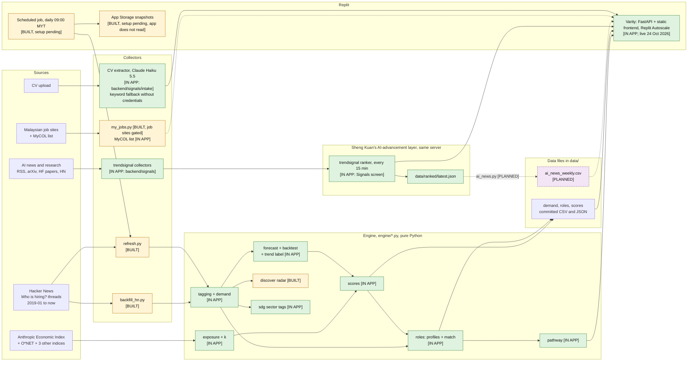
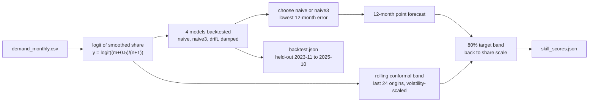
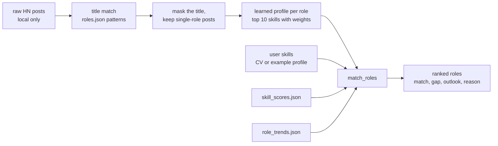
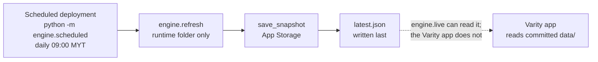
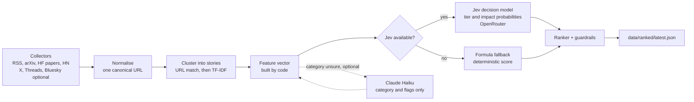
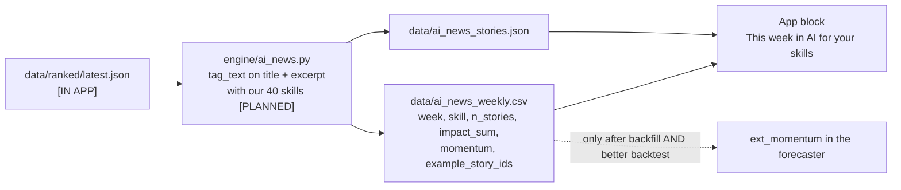
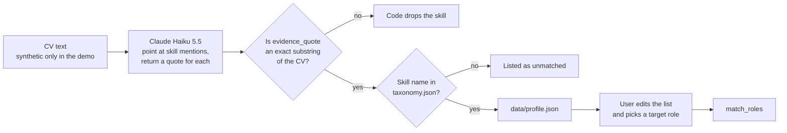
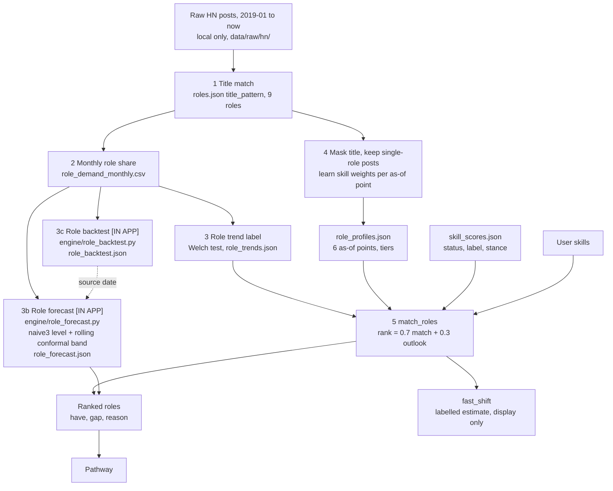
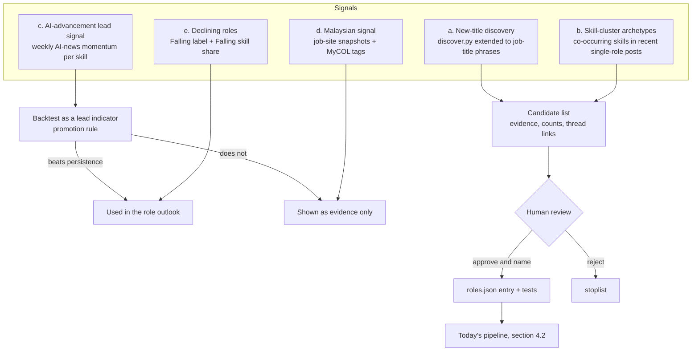

# Verity: architecture

Team Hokkien Mee Is Purple (Ee Zhan, Sheng Kuan). XMUM SDC Hackathon 2026, Domain 1.
Written 23 Oct 2026 on branch `docs/architecture`; updated 24 Oct 2026 on branch `feat/varity-only`. The Streamlit UI was retired on 24 Oct: Varity (FastAPI backend plus a static web app) is the only app. The status table in `docs/build-plan.md` is the source of truth for what is built.

## How to read this document

Every component has one status tag.

| Tag | Meaning |
|---|---|
| **[IN APP]** | Built and tested, and the Varity app uses it (directly, or through the data files it reads). The live site runs it (published 24 Oct 2026). |
| **[BUILT]** | Built and tested, but the Varity app does not use it. It runs offline, as evidence, or is gated. |
| **[PLANNED]** | Not built. A design only. |

A planned part never appears as a working part. Every number comes from a file. The file is in brackets, for example (data/backtest.json). When a number has no file, it is left out.

---

## 1. Purpose and the user

Verity helps a junior or mid-level tech developer in Malaysia plan a career move. The user is, for example, "Aina, a junior Python developer" (a synthetic example profile in `data/example_profiles.json`). Verity shows which skills are rising or falling in dated public job data. It ranks future roles by how well the user's skills match them. It then turns the skill gap into an ordered plan with daily tasks. Every number shows its source and date, and the user makes the decision. Tech roles are the starting group, because they have the best free, dated, public data.

### Design principles

1. **Code computes every number.** A language model never produces a score, a rank, a forecast or a date.
2. **LLMs only point or word things.** An LLM may point at skill mentions in a CV or write a sentence. Code checks what it returns. The forecast, role match, pathway dates and SDG parts are code. Only the CV intake and two optional steps (the route advisor and the pathway coach) use an LLM, within code's limits (section 3.19).
3. **Every number has a source and a date.** The app shows both.
4. **Tested before trusted.** A method enters the product only if a backtest on held-out data supports it. The simple method won the forecast test, so it ships (data/backtest.json).
5. **The human decides.** Verity shows estimates and labels them. New skills and new roles need a person to approve them.
6. **Public or synthetic data only.** No scraping behind a login or a bot challenge. No real CVs in the demo.

---

## 2. System overview

Green nodes are in the Varity app. Yellow nodes are built but not used by the app. Dotted arrows are planned or gated links.

The shape of the system:

- **The engine is plain Python.** It reads files in `data/` and writes files in `data/`. It has no server and no database.
- **One server, one app.** Varity is a FastAPI backend (`backend/signals`, started with `python -m trendsignal serve`) that serves the static frontend in `frontend/` at `/` and the JSON APIs under `/api`. The frontend is plain HTML, CSS and JavaScript with no build step. The Streamlit app (`app.py`) is retired.
- **The backend reads files.** It imports the engine for role match and pathway, and reads the engine's output files in `data/` at request time. The Varity screens are Flow map, CV & routes, Today, Pathway, Signals, Job forecast, Skills radar and Method (section 3.16). An "Expected" or "If AI speeds up" scenario toggle (both labelled estimates; the API values are still `moderate` and `fast`) sits on the routes.
- **Sheng Kuan's AI-advancement layer runs in the same server.** It re-ranks every 15 minutes when the server starts with `--scheduler`, and it serves the Signals screen (`GET /api/signals`). A link from its ranked file to the skill forecast is still a design (section 3.17).
- **Collectors write counts, not text.** Raw post text stays in the gitignored folder `data/raw/`. Only aggregates and thread links are committed.

---

## 3. Components

### 3.1 Skill taxonomy and tagger [IN APP]

- **What it does.** Finds which of the 40 tech skills a job post mentions.
- **Inputs.** `data/taxonomy.json` (40 skills; each has `skill`, `category`, `synonyms`, `pattern`, `case_sensitive`, `sdg`, `sdg_reason`). Post text, as HTML.
- **Outputs.** A set of canonical skill names per post.
- **Key functions.** `engine/tagging.py`: `load_taxonomy`, `clean_text`, `tag_text(text, taxonomy)`.
- **Why built this way.** Regular expressions give the same result on every run. They cost nothing and a judge can read them. Counting rules are plain: a post that says "PostgreSQL" counts as PostgreSQL only, not as SQL. "React Native" is not React. A bare "AI" in a company blurb is not a skill, so Machine Learning needs real skill words (docs/build-plan.md, P1). "JavaScript / TypeScript" is one combined row, and TypeScript also keeps its own row.
- **How tested.** `tests/test_tagging.py` covers the hard names, for example Go, R, C, C++, C#, Swift.
- **Status.** [IN APP]

### 3.2 Hacker News backfill and refresh [BUILT]

- **What it does.** Downloads every monthly "Ask HN: Who is hiring?" thread from Jan 2019. Updates the current month on demand.
- **Inputs.** The public Algolia HN API. One request at a time, with pauses and retries.
- **Outputs.** `data/hn_threads.csv`: 94 threads, 48,508 top-level posts, Jan 2019 to Oct 2026 (data/hn_threads.csv). Raw JSON goes to `data/raw/hn/` (local only).
- **Key functions.** `engine/backfill_hn.py`: `list_threads`, `fetch_latest_thread`, `upsert_thread_row`. `engine/refresh.py`: `refresh(work_dir)`.
- **Why built this way.** The source is free, dated, monthly and tech-specific. Each thread has a URL to cite. `refresh()` never writes into the committed `data/` folder. It copies the files to a runtime folder, fetches the newest thread, recomputes only that month, and rebuilds the scores there. If the network fails, it keeps the last good data and returns an error dict instead of raising.
- **How tested.** `tests/test_refresh.py`, `tests/test_demand.py`.
- **Limit.** The source is US- and startup-heavy (docs/build-plan.md, risks).
- **Status.** [BUILT]. The Skills radar "Trend data" bar has a "Fetch latest HN" button (`POST /api/data/refresh`, no token). The server starts at most one fetch per 10 minutes for all viewers; otherwise it returns 429 with `retryAfter`. There is no stored-snapshot banner. Without a fetch, the app shows the committed snapshot (as of 2026-10).

### 3.3 Demand series and AI-context series [IN APP]

- **What it does.** For each skill and month, computes the share of posts that mention the skill. A second series holds the share of posts that mention AI at all.
- **Inputs.** `data/hn_threads.csv`, raw posts, `data/taxonomy.json`.
- **Outputs.** `data/demand_monthly.csv` (month, skill, mentions, n_posts, share, share_smooth, thread_id, thread_url). `data/ai_context_monthly.csv`, which runs from 6.4% in 2019-01 to 54.6% in 2026-09 (data/ai_context_monthly.csv).
- **Key functions.** `engine/demand.py`: `build_demand`, `build_all`, `update_months`.
- **Why built this way.** Share, not count: posts per month fell over the years, so raw counts would make every skill look like it is dying. A post counts once per skill. The smoothed share is trailing, so no future month changes a past value. The AI-context series measures company context ("we are an AI startup"), not a skill, so it stays separate.
- **How tested.** `tests/test_demand.py`.
- **Status.** [IN APP]

### 3.4 AI exposure, cross-check indices and the k estimate [IN APP]

- **What it does.** Gives each skill an AI exposure value and a stance: AI-complement, neutral or AI-substitutable. It then checks that stance against other indices and asks what the job data say about the scenario strength `k`.
- **Inputs.** Anthropic Economic Index (AEI) release 2026-06-26 (CC BY), O*NET occupations, plus the GPTs-are-GPTs, AIOE and Microsoft "Working with AI" indices. Raw files are local only (data/SOURCES.md).
- **Outputs.** `data/exposure_occupations.csv`, `data/exposure.csv` (one row per skill, with `e_s` and stance). `data/exposure_indices.csv`, `data/exposure_agreement.json`, `data/exposure_robustness.csv`. `data/k_estimate.json`.
- **Key functions.** `engine/exposure.py`: `build_occupations`, `stance_for`, `build_exposure`. `engine/exposure_indices.py`: `build_agreement`, `agreement_for_category`. `engine/k_estimate.py`: `estimate`, `k_from_b`.
- **Why built this way.** Version 1 measured task traffic, which is popularity, not exposure. Version 2 uses the share of conversations where the AI did the task. The category-to-occupation map is team judgement and says so (data/SOURCES.md). The cross-check does not change the production stance. It adds a flag, `stance_robust`.
- **What the checks found.** Only the `language` category (14 skills) is robust. The other five categories are contested (data/exposure_agreement.json). The data cannot pin `k` down. The cluster-bootstrap 95% interval for k per 12 months runs from -1.04 to 2.91, so the assumed k = 2 is inside it, and so is k = 0 (data/k_estimate.json). `k = 2` stays a labelled assumption.
- **How tested.** `tests/test_exposure.py`, `tests/test_exposure_indices.py`. The k test checks the linearisation formula.
- **Limit.** `exposure.csv` is from the 2026-06 release. It is not cut by date, so past views use today's exposure.
- **Status.** [IN APP]. Merged in PR #6. The Method screen shows the cross-check and the k estimate. The cloud_devops stance is an open decision (section 9).

### 3.5 Forecast (naive3) and the rolling backtest with conformal bands [IN APP]

- **What it does.** Predicts each skill's share of posts 12 months ahead, with an 80% target band. The backtest measures how good that is.
- **Inputs.** `data/demand_monthly.csv`.
- **Outputs.** The forecast fields inside `data/skill_scores.json`. All backtest numbers in `data/backtest.json`.
- **Key functions.** `engine/forecast.py`: `forecast_skill`, `choose_model`, `band_offsets`, `build_residual_tables`. `engine/backtest.py`: `run_backtest`, `evaluate_bands`. `engine/scores.py`: `build_scores(as_of, ...)`.
- **Why built this way.** The test chose the simplest model. On held-out origins (2023-11 to 2025-10) the 12-month mean error is 1.661 pp for naive3, 1.806 for naive, 2.128 for drift and 2.266 for damped (data/backtest.json). Job demand 12 months ahead is close to "no change", so the trend models lose. The band comes from the errors of the last 24 forecasts whose outcome is known, scaled by how noisy the skill is. On held-out origins the 80% band covered 93.8% of real values at 12 months (data/backtest.json). That is above target, so the band is wide, not tight. We say so in the app.
- **No look-ahead.** `build_scores(as_of)` uses only data with a known outcome by `as_of`. The earliest supported `as_of` is 2023-11 (data/skill_scores.json). The Skills radar can replay a past month for one viewer: the browser keeps the month in `sessionStorage` and sends `?asOf=YYYY-MM` on the roles, pathway, radar and status calls (a bad month returns 422; no server state). The `as_of` argument is also used by the backtest and the tests.
- **How tested.** `tests/test_forecast.py`, `tests/test_backtest.py` (including tests that a changed future leaves the past unchanged), `tests/test_scores.py`.
- **Status.** [IN APP]. The Skills radar screen shows the skill forecast from `data/skill_scores.json`; the Method screen shows `data/backtest.json`.

### 3.6 Trend label (Welch test) [IN APP]

- **What it does.** Labels each skill Rising, Falling or No clear change. The label describes what already happened. It is not a forecast.
- **How.** A Welch t-test on the monthly logit share compares the last 12 months with the 12 before. p below 0.05 gives Rising or Falling. A skill needs at least 30 mentions in the 24 months (`TREND_MIN_MENTIONS` in `engine/forecast.py`).
- **Key function.** `engine/forecast.py`: `trend_label(y_last24, mentions_last24)`.
- **Why built this way.** The brief asks which skills emerge or decline. The best forecast is "about the same". So the app shows an observed, tested label next to the forecast level and band.
- **How tested.** In the backtest, a Rising or Falling label pointed the right way over the next 12 months in 67.2% of 720 labelled cases (data/backtest.json). The hit rate for Rising is 60.5% and for Falling 71.9%. The same file warns that nearby origins overlap. `tests/test_forecast.py`.
- **Status.** [IN APP]

### 3.7 Data-volume statuses [IN APP]

- **What it does.** Stops the app from showing unreliable forecasts for skills with few posts.
- **Rules.** `ok`: mean of 5 or more mentions per month over the last 12 months. Forecast, band and scenarios are shown. `low_volume`: below that, but 30 or more mentions in 24 months. Counts and label only. `rare`: under 30 mentions in 24 months. Counts only.
- **Result today.** 27 `ok`, 8 `low_volume`, 5 `rare` (data/skill_scores.json).
- **Key function.** `engine/forecast.py`: `skill_status`.
- **Why built this way.** An earlier version hid emerging skills. Now they appear with honest counts.
- **Status.** [IN APP]

### 3.8 Scenarios (Expected and "If AI speeds up") [IN APP]

- **What it does.** Shows two futures per skill. "Expected" (API value `moderate`) is the forecast. "If AI speeds up" (API value `fast`) is `moderate * (1 - k * e_s)`, where `e_s` is the skill's exposure minus the mean over the 40 skills. `k = 2` is shown as an assumption (data/skill_scores.json, `scenario_params`).
- **Key function.** `engine/scores.py`: `fast_scenario`.
- **Why built this way.** The brief asks for more than one scenario, labelled as estimates. One stated formula is easy to explain and to challenge. The app labels both scenarios as estimates. The "If AI speeds up" band is never graded: only the Expected band is backtested (`engine/backtest.py`).
- **How tested.** `tests/test_scores.py`.
- **Status.** [IN APP]

### 3.9 Role match [IN APP]

- **What it does.** Ranks 8 future tech roles for a user. Each role shows a match score, the skills the user has, the skills missing, the role's trend and one plain sentence.
- **Inputs.** `data/roles.json` (9 roles, 8 ranked), raw posts for learning, `data/skill_scores.json`, the user's skill set.
- **Outputs.** `data/role_profiles.json`, `data/role_demand_monthly.csv`, `data/role_trends.json`. No file holds post text.
- **Key functions.** `engine/roles.py`: `learn_profile_set`, `profile_for(as_of, doc)`, `build_role_trends`, `match_roles(user_skills, role_profiles, skill_scores, role_trends, scenario, exposure, k)`.
- **How it works.**
  - A post belongs to a role if its text matches the role's `title_pattern`.
  - The matched title is masked before skills are tagged, so "LLM engineer" does not create an LLM skill by itself.
  - Profiles use only posts that name exactly one role.
  - A skill needs at least 10 single-role posts, `p_role` of at least 0.08 and lift of at least 1.1. The top 10 by `p_role` stay, and their weights sum to 1.
  - Confidence tiers: `solid`, `rough` or `not_ranked`. Today four roles are solid, four are rough and one (Analytics Engineer) is not ranked (data/role_profiles.json).
  - `rank_score = 0.7 * match_score + 0.3 * future_score`. `future_score` is 1.0 for Rising, 0.5 for No clear change or unknown, and 0.0 for Falling. The 0.7 and 0.3 are team judgement, not fitted to data. A role with match below 0.20 is not ranked. The routes on the CV & routes screen use this formula. An optional language-model advisor (section 3.19) may re-order the roles by at most 2 places; the fit label always comes from code.
  - One profile exists per as-of point (2023-12, 2024-06, 2024-12, 2025-06, 2025-12, 2026-10). `profile_for` picks the latest point at or before the chosen month, so a profile never saw later posts. With `?asOf=`, the app uses the profile for that month; otherwise it uses the latest.
- **Why built this way.** Weights learned from real posts can be cited. Weights we invented could not.
- **How tested.** `tests/test_roles.py`.
- **Limit.** The daily refresh rebuilds the current month's role demand, trends, backtest and forecast (`_update_roles` in `engine/refresh.py`); on failure it restores the old role files. The learned profiles are still rebuilt by hand from the raw posts (`python -m engine.roles --raw-dir ...`).
- **Status.** [IN APP]

### 3.10 Reskilling pathway [IN APP]

- **What it does.** Turns the skill gap for a target role into an ordered plan, then into dated daily tasks. The Pathway and Today screens are built from it for the saved profile and the chosen route. The browser builds the `.md` and `.ics` downloads.
- **Inputs.** The gap from role match, `data/skill_scores.json`, `data/resources.json`, scenario, hours per week, start date.
- **Outputs.** A plan object (`GET /api/pathway`). The `.md` and `.ics` exports are built in the browser.
- **Key functions.** `engine/pathway.py`: `build_pathway`, `classify`, `schedule_tasks`, `progress`, `to_markdown`, `to_ics`, `sdg_headline`.
- **How it works.** Each gap skill goes to the first stage it fits. Stage 1, `no_regret`: needed by 2 or more of the counted roles, not Falling, not AI-substitutable. Stage 2, `near_term`: in the top half of the gap skills by share now. Stage 3, `future_bet`: Rising or AI-complement. The "If AI speeds up" (`fast`) scenario moves stage 3 to second place. Tasks last at most 45 minutes on Monday to Friday, with dates in Malaysia time.
- **Why built this way.** Code sets the dates and builds the order. The optional pathway coach may re-order steps within a stage, pick among the listed resources and write one checked "why" line; it never changes a date, a minute count or a stage. A resource can come only from `data/resources.json`, and only if its link returned HTTP 200 (77 resources for the 40 skills, checked on 2026-10-22, docs/pathway.md). A skill without a verified resource gets no task. The engine never invents a course. HRD Corp: only the programmes in `data/hrd_programmes.json` (3 entries, each with the provider's own claim statement and a check date) show an HRD Corp option. All other resources make no claim.
- **How tested.** `tests/test_pathway.py`, including a test that every chosen link exists in the resource list.
- **Status.** [IN APP]. "What changed and why" (a full diff view between two runs, `data/diff.json` in the contract) is [PLANNED]. Google sign-in and two-way Google Tasks sync are not built; the Flow map says so. One-way push of today's stops to Google Tasks is built (needs `GOOGLE_CLIENT_ID`). Replit sign-in is built (section 3.20).

### 3.11 New-skill discovery radar [BUILT]

- **What it does.** Lists terms that are not in the 40-skill taxonomy but look like tech names, with evidence. A person decides whether to add one.
- **Inputs.** The raw posts. `data/discover_stoplist.txt`.
- **Outputs.** `data/skill_candidates.json`. The Varity app does not show it (the Streamlit candidate radar was removed).
- **Key functions.** `engine/discover.py`: `extract_terms`, `discover(as_of, ...)`, `history`, `backtest`.
- **How it works.** Four plain rules find terms: camel case, tech style (dots, digits, `++`, `#`), all caps, and a single word inside a list that already holds 2 taxonomy skills. A term needs 30 or more posts in the last 12 months. Score is growth times a weight for list-style use.
- **Why built this way.** The taxonomy is fixed, and a new tool can become popular unseen. The tool never edits the taxonomy.
- **How tested.** The backtest is weak, and the file says so. At 2023-06, 3 of the top 15 terms kept growing (precision 0.20, base rate 0.30 over 47 candidates) (data/skill_candidates.json). The tool also sees a new tool 1 to 3 years after its first mention (docs/skill-discovery.md). So it surfaces candidates and does not forecast. `tests/test_discover.py` checks that the output holds no post text.
- **Status.** [BUILT]. Not used by the Varity app.

### 3.12 ML forecaster experiment (lost, kept as evidence) [BUILT]

- **What it does.** Tests whether one pooled gradient-boosting model beats "about the same". It predicts a correction on top of naive3.
- **Inputs.** The demand series, the AI-context series, `exposure.csv`. A placeholder column `ext_momentum` is empty.
- **Outputs.** `data/ml_backtest.json`. The app does not read it.
- **Key functions.** `engine/ml_forecast.py`: `build_panel`, `forecast_h12`. `engine/ml_backtest.py`: `run_ml_backtest`, `decide`.
- **Result.** On held-out origins the ML error was 2.064 pp and naive3 was 1.661 pp. The 95% interval of the gain excludes zero, so ML is worse (docs/ml-forecaster.md, data/ml_backtest.json). The verdict is "keep naive3". Production does not use it.
- **Why we keep it.** It answers the judge question "why not machine learning?" with a fair test. The rule was fixed in advance: promote only if the lower end of the 95% interval of the gain is above 0. The code is ready to take Sheng Kuan's ranker momentum through `ext_momentum` (sections 3.17 and 4.3).
- **How tested.** `tests/test_ml_forecast.py`: no leak, determinism, `naive3 + correction`.
- **Dependency.** `scikit-learn` sits in `requirements-dev.txt`, not on Replit.
- **Status.** [BUILT] as evidence. Not used in production.

### 3.13 Scheduled refresh and store [BUILT, Replit setup pending]

- **What it does.** Re-downloads the newest HN thread each day, rebuilds the scores, and saves the result in App Storage.
- **Inputs.** The public HN API. No secret is needed.
- **Outputs.** Snapshots under `snapshots/<UTC time>/` in the bucket (`skill_scores.json`, `demand_monthly.csv`, `hn_threads.csv`, `ai_context_monthly.csv`, `meta.json`). `latest.json` points to the newest and is written last. The newest 14 snapshots are kept.
- **Key functions.** `engine/scheduled.py`: `run`. `engine/store.py`: `LocalStore`, `ReplitStore`, `get_store`. `engine/live.py`: `start_dir`, `publish`, `banner`. `engine/live.py` is unused by the Varity app.
- **Why built this way.** On Replit a redeploy replaces the disk. A failed run never changes `latest.json`, so a reader keeps the last good data.
- **Limit.** The Varity app reads `data/` files. The in-server scheduler (`--scheduler`) runs `forecast_refresh` daily at 06:30 and `retention` at 06:45 (server time zone setting). The app does not read the stored snapshots.
- **How tested.** `tests/test_store.py`, `tests/test_scheduled.py`, `tests/test_refresh.py`.
- **Status.** [BUILT]. The Replit UI steps (create the bucket, create the Scheduled deployment) are not done yet (docs/replit-schedule.md).

### 3.14 SDG sector links [IN APP: role and skill tags, goal picker and re-rank]

- **What it does.** Links roles and skills to Sustainable Development Goals through the sectors that hire for them.
- **Inputs.** The raw posts (employer descriptions), `data/roles.json`, `data/sdg_sectors.json` (sector patterns).
- **Outputs.** `data/role_sdg.json` and `data/skill_sdg.json`. Counts, shares and thread URLs only.
- **Key functions.** `engine/sdg.py`: `rerank_for_goal(match_roles_output, role_sdg, goal_sector)` and `plan_sdg_summary(plan, role, role_sdg, goal_sector)`.
- **Why built this way.** The SDG tag is measured from what employers say, not written by hand. Perk and legal lines are removed first, so a benefits line does not tag a post as health.
- **In the app.** Each route carries SDG tags from these files. CV & routes has a goal picker and a reason line per role ("Most over-represented sector" or "Main SDG-linked sector"), plus a "too few posts to re-rank" note. On the pathway, goal-linked skills move first inside each stage (`plan_sdg_summary`). Thresholds are not lowered, so with today's data the route order does not change.
- **Limit.** The sector shares are one build (HN only, a US-heavy sample).
- **Status.** [IN APP]. `rerank_for_goal` is wired in.

### 3.15 Malaysian data [IN APP: MyCOL badges; job-site collectors BUILT, gated]

- **What it does.** Adds a small Malaysian cross-check: how often skills appear in Malaysian job-site result pages on one day, and whether a role or skill is on the MyCOL critical occupations list.
- **Key code.** `engine/my_jobs.py` (collector). It checks `robots.txt` for every URL, sends at most 1 request per 3 seconds per host, uses one honest User-Agent, keeps no login or cookies, and stops that site for the run on any challenge page. It strips emails, phone numbers and contact lines. Only aggregates are committed.
- **Why built this way.** The HN series is US-heavy. This data is local evidence. It is not a time series: each run is one dated snapshot with no history, so it cannot feed the forecast.
- **JobStreet.** Stopped. The site answers a plain request with a Cloudflare challenge (HTTP 403), and passing it from a script would bypass bot protection. No scraper was built (`docs/jobstreet.md` on branch `feat/jobstreet-my`). The route needs a data partnership or a file the site sends us (section 9).
- **MyCOL.** `data/mycol.json` holds 10 tech-relevant occupations from the MyMahir MyCOL 2024/2025 list (TalentCorp). `data/mycol_role_map.json` maps them to our roles, with a strength (direct or partial) and a reason for each link. It is team judgement and says so. The route cards on the CV & routes screen show a badge for each mapped occupation ("MyCOL shortage occupation: ... our direct or partial match (team judgement)"), with its MASCO code and the source link. Occupation names and MASCO codes were read by eye from the PDF's page images. A role with no mapping shows nothing. MyCOL is a shortage list, not a vacancy count (docs/malaysia-data.md).
- **Job-site snapshots (gated).** The collectors for Hiredly and Jobstore are built and tested, but no snapshot has been collected: `data/my_jobs_snapshots.csv` and `data/my_roles_snapshots.csv` hold only their header row. A run needs `--permission-confirmed`, which means written permission from the site is on file. The Method screen does not show job-site snapshots.
- **Status.** MyCOL badges [IN APP]. Job-site collectors [BUILT], gated: built, not run; the Varity app does not show the Malaysia jobs snapshot table (removed with Streamlit). The JobStreet finding is a document only.

### 3.16 Varity web app [IN APP]

- **What it does.** The only user interface. A static page in `frontend/` (HTML, CSS, JavaScript, no build step) served by the FastAPI backend at `/`. It has eight screens:
  - **Flow map**: the planned user flow as a transit map. It says that Google sign-in and two-way Google Tasks sync are not built. Replit sign-in is built (section 3.20).
  - **CV & routes**: CV upload (section 3.18), or "Try an example" with 3 synthetic profiles (`data/example_profiles.json`), which needs no LLM. Routes are ranked by `0.7 * match + 0.3 * outlook` (section 3.9). Reasons are typed chips with a source and a date (section 3.19). Each route has SDG tags and MyCOL badges. An "Expected (estimate)" or "If AI speeds up (estimate)" scenario toggle sits on the routes (API values `moderate` and `fast`). A goal picker (SDG) and a reason line per role are built (section 3.14). The free resource under a stop can show an HRD Corp option from `data/hrd_programmes.json`.
  - **Today**: the next stops, taken from the pathway.
  - **Pathway**: the ordered stops from the saved profile to the chosen route (`engine/pathway.py`). `.md` and `.ics` downloads are built in the browser.
  - **Signals**: the AI-trend ranker output (section 3.17), dated and updated.
  - **Job forecast**: `data/role_forecast.json` (section 4.2).
  - **Skills radar**: `engine.radar` and `data/skill_scores.json`, with the skill forecast.
  - **Method**: backtests, the AI exposure cross-check, k as an assumption, and sources. `trendsignal/web/evidence_api.py` reads these from `data/` at request time.
- **Offline behaviour.** `frontend/data.js` keeps only dated real snapshots, labelled "offline snapshot". If the server cannot be reached, the page says so. No synthetic data is shown as real.
- **Key code.** `frontend/app.js`, `frontend/screens*.js`, `backend/signals/trendsignal/web/` (`app.py`, `cv_api.py`, `roles_api.py`, `evidence_api.py`, `auth_api.py`, `accounts_store.py`). In `engine/radar.py`, a skill gets a colour only if its Welch label is Rising or Falling. Every other skill is grey, so the chart never claims a change the test did not find.
- **Removed from the Streamlit version.** The Reload button and the stored-snapshot banner; the Evidence skills table with filters, the skill detail tab, the Malaysia jobs snapshot table, the AI-in-posts chart and the candidate new-skills radar.
- **Also built.** A privacy page (`frontend/privacy.html`, PDPA, 7 principles) and a consent tick before a CV upload. Skills radar has a "Trend data" bar (replay a past month, back to latest, Fetch latest HN; see sections 3.2 and 3.3). Each route card has a "Why NN%?" panel. A Team (HR) view was built and removed on 1 Nov (it did not fit a worker-facing site).
- **Status.** [IN APP]. Live, published 24 Oct 2026.

### 3.17 AI-advancement ranker (Sheng Kuan) [IN APP] and its integration [PLANNED]

This is a package inside the same server, `backend/signals/trendsignal/` (pull request 16). Its design is in `backend/signals/ARCHITECTURE_JEV_RANKER.md`. The principle is: code extracts, Jev decides, code ranks. Jev may rank signals through OpenRouter, but `TRENDSIGNAL_RANKER` defaults to the formula. Optional Claude use (category fallback, prose brief) is off by default. With `--scheduler` the server re-ranks every 15 minutes. On a fresh deploy with no ranked run, one pipeline pass starts in the background (`bootstrap_if_empty` in `trendsignal/jobs.py`). This is the live, dated, updatable AI-trend source of the app.

- **What it does.** Collects AI and tech updates, merges duplicate reports into stories, and ranks the stories by impact.
- **Outputs.** `data/ranked/latest.json` (rank, title, link, sources, tier probabilities, expected impact, confidence, final score, top features).
- **Why built this way.** The feature vector is code only, so every rank can be reproduced. A formula always runs, so if Jev fails, times out or is not configured, the formula ranks and the row says so. The promotion rule says Jev ranks by default only if it beats the formula on a hand-labelled gold set.
- **How tested.** The package has its own test suite and runs without network. A branch review found 211 tests passing.
- **Status.** [IN APP]. It serves the Signals screen of the Varity web app (`GET /api/signals`). Live, published 24 Oct 2026.

**Integration. [PLANNED]**

- `engine/ai_news.py` tags each story with our 40 skills, using `tag_text` on the title and a non-LLM excerpt.
- It writes `data/ai_news_weekly.csv` (week, skill, n_stories, `impact_sum` from `formula_score`, momentum, `example_story_ids`) and `data/ai_news_stories.json`.
- The app shows a block "This week in AI for your skills".
- The integration uses `formula_score`, not Jev's probabilities, so the numbers do not depend on a model that has no key yet.
- Feeding `ext_momentum` into the forecaster happens only after a historical backfill and only if the backtest improves (section 4.3 and 4.4).
- **Status.** [PLANNED]

### 3.18 CV intake with Claude Haiku 5.5 [IN APP]

- **What it does.** Reads a CV and returns skills, each with an exact quote from the CV. Code reads the years of experience. The design is in `docs/skill-profile-intake-architecture.md`. The code is in `backend/signals/intake/`.
- **Contract.** One Claude call returns `{skill, evidence_quote, years}` as schema-constrained JSON. The LLM points. Code proves: it drops any skill whose quote is not in the CV text, word for word. Skill names must match the skill graph.
- **Model and credentials.** The CV intake uses Claude Haiku 5.5 (`claude-haiku-5-5`) through the Anthropic API. The team sets `ANTHROPIC_API_KEY` (a team member's key) in Replit Secrets and Production app secrets, and Anthropic bills that account. With no key, a keyword pass takes over. The code can also use Replit AI Integrations (`claude-haiku-4-5`) when no key is set; the team does not use that route. The CV-intake call is not yet confirmed on the live app. The route advisor was confirmed live with a synthetic example profile. "Try an example" on the CV & routes screen skips the LLM: it loads one of 3 synthetic profiles from `data/example_profiles.json`.
- **Cost cap.** A daily spend counter caps intake at $1 per day (`VERITY_INTAKE_DAILY_BUDGET_USD`, default 1.0).
- **Why built this way.** The check stops the LLM from inventing a skill. The LLM does not score or rank.
- **Human control.** The user can remove or add skills and sets the target role.
- **Data.** Synthetic CVs only. No real CVs. CV text goes to Anthropic directly. A PDPA assessment and a retention rule are needed before real uploads (docs/submission/qa-prep.md).
- **Owner.** Sheng Kuan.
- **Status.** [IN APP] (pull request 16). The CV page is the CV & routes screen.

### 3.19 Role advisor and reason chips [IN APP]

- **What it does.** Adds a reason to each ranked route. Reasons are typed chips, each with a source and a date. Code writes every chip (`backend/signals/advisor/chips.py`).
- **Optional LLM step.** `backend/signals/advisor/llm.py` may re-order the roles by at most 2 places from the formula rank, and it only picks among chips that code wrote. Code checks the answer. The fit label is always code's. Without credentials, the formula order stands. A second optional step, the pathway coach, may re-order steps inside one stage and pick among resource links that code listed; code checks it the same way.
- **Why built this way.** The LLM never produces a score, a rank outside the 2-place limit, a number or a date (section 1, principle 2).
- **Status.** [IN APP]. Live, published 24 Oct 2026.

### 3.20 Optional accounts [IN APP; not yet tested on the live Replit app]

- **What it does.** A user can click "Sign in" and use Replit Auth. Signing in is optional: the whole app works without it ("Try an example", or the browser token `X-Profile-Token`). A signed-in user keeps the profile across devices and restarts.
- **Sign-in flow.** OpenID Connect with PKCE (S256). The client id is the Repl's `REPL_ID` and the issuer is `https://replit.com/oidc`. Routes in `backend/signals/trendsignal/web/auth_api.py`: `/api/login/prepare`, `/api/login`, `/api/callback`, `/api/me`, `/api/logout`. Login is on only when `REPL_ID` and `SESSION_SECRET` are set.
- **Session.** A signed HttpOnly cookie (HMAC-SHA256 with `SESSION_SECRET`), 30 days, SameSite=Lax. Sign out also ends the Replit session.
- **What is stored.** Per account (table `users`): the Replit user id (`sub`), email, display name, profile image URL, and the created and last-login times. Per profile: the skill ledger, the target role and the pathway tick progress. Also the cleaned CV text (for the CV builder; deleted with the profile). Never the uploaded file and never tokens.
- **Where.** `backend/signals/trendsignal/web/accounts_store.py`. Replit PostgreSQL when `DATABASE_URL` is set, else the SQLite file.
- **Delete and move.** `DELETE /api/me` removes the user and the profile. An anonymous profile moves into the account on the first sign-in.
- **Not built.** Google sign-in and syncing ticks back from Google Tasks. Only Replit sign-in exists. Pushing today's stops to Google Tasks is built: the browser uses Google Identity Services for a Tasks-only token and calls the Tasks API directly.
- **Status.** [IN APP]. Local tests and a local signed-in walkthrough only; not yet tested on the live app.

---

### 3.21 Project and Cert stations [IN APP; jury and GitHub App not yet tested live]

- **Why.** Judge feedback: finishing tasks does not close a skill gap. Each skill now has an evidence level: Learned (pathway tasks ticked), Applied (a project passed review), Certified (a verified Credly badge). Plan: `tasks/plan-projects-certs.md`.
- **Match score.** `match = sum(weight * credit) / total weight`. Credit is 1.0 for CV, Applied and Certified evidence, and `LEARNED_CREDIT = 0.5` (an assumption, `advisor/mapping.py`) for a skill backed only by ticked tasks. The Why panel's raise list also offers "prove X" (`engine/roles.py score_breakdown`, kind `prove`).
- **Projects.** `data/projects.json` (hand-curated, real public sources). Rank = match gain if the project passes (`proof/catalog.py`), a formula. The "Why" line is a code template from the formula's facts (not an LLM sentence yet).
- **Review.** `trendsignal/web/proof_api.py`. Hard checks first, no LLM (`proof/github.py`): repo readable, owner (verified only with GitHub connect), not a fork, 5+ commits on 3+ days, latest Actions run passed, PR merged (issue projects), demo returns 2xx/3xx on a public https host. Then the live jury (`proof/jury.py`): Claude Haiku (Replit), `gpt-5.4-mini` and `deepseek-v4-flash` (KrackedDevs) vote per criterion on picked files (max 8 files, 24k chars). A pass counts only if the cited `path:line` holds the quoted text. 2 of 3 decide; fewer agreeing answers give "delayed", never a pass. Passed: each criterion skill gets `jury_pass` evidence. One dispute per failed item.
- **Certs.** `data/certs.json` (hand-curated, no prices). Rank = share of HN posts for the role that name the cert (`engine/cert_demand.py` -> `data/cert_demand.json`) x syllabus coverage; coverage alone until that file exists. "I passed" checks a Credly badge (`proof/credly.py`): issuer, title, state, expiry. Else "self-reported".
- **Re-plan.** A failed item (or a cert syllabus skill) not on the route gives a service-change band. Keep adds it as a pushed skill (`planner.answer_offer`), Revert hides it for 30 days.
- **GitHub (URL only, 1 Nov).** GitHub connect and the webhook were removed by decision. The user pastes a public repo link; the server reads it with its read-only `GITHUB_TOKEN`. Every repo is "Unverified owner". Private repos cannot be reviewed.
- **Why line (1 Nov).** `proof/why.py`: DeepSeek V4 Flash (KrackedDevs, else Claude) writes one sentence from the formula's facts. Code shows it only when every number in it is the rounded gain and it names every skill the project closes. Else the template (`catalog.why_line`) shows. One call per project, role and week, cached in the server process.
- **Storage.** `owner_proof` (owner-keyed, moved and deleted with the profile, so the 365-day purge covers it).
- **Frontend.** `frontend/screens-proof.js`, `frontend/proof.css`: proof line, platform sign, Departures timetable, submit form, jury tracks, certs, Today checklist, Applied / Certified counts on CV & routes.
- **Review fixes (1 Nov).** Citations must hold the quote on the exact cited line, and only lines shown to the juror count. A dispute also stops at a failed hard check. Commit spread uses GitHub push times (events API), so backdated commits do not count. Ownership with GitHub connect = the repo is in the user's app installation. Expired user tokens are refreshed; else "Reconnect GitHub". Public reads use the server's `GITHUB_TOKEN` and cache each file once per review. The review lock is a database row (`proof_review_locks`, stale after 10 min), so it works across server copies and restarts. No per-user cap (by decision): a repeat review needs new commits. Consent can choose Claude + GPT only for private repos (then both must pass). Credly flags a badge whose earner name does not match the account name. Webhook events are deleted after 30 days. The Method page shows the 0.5 credit as an assumption. A synthetic sample review (`frontend/demo-review.json`) is shown when no project is on board.
- **Not built.** Live collectors for GitHub issues, Kaggle and HN project briefs (the catalog is hand-curated), the LLM "why" sentence. The offline jury eval is dropped (user, 1 Nov). Stored GitHub tokens are not encrypted (no crypto library in the project).
- **Tests.** `backend/signals/tests/test_proof.py`.

---

## 4. Predicting future job roles: architecture

### 4.1 What "predict" means here

Verity does not predict the number of jobs. It predicts a role's **share of job posts** in a public sample.

- **Role demand** is the monthly share of HN hiring posts whose text names the role. A title pattern in `data/roles.json` decides the match.
- **The outlook** is the same machinery as for skills: a persistence level (naive3, the mean of the last 3 months on the logit scale), a rolling conformal band and a Welch trend label. Persistence won the skill backtest, so we tested it for roles instead of assuming it (section 4.4).
- **The role's skills** are learned from single-role posts, at as-of points, so a profile never saw posts from after its date.

The trend label and the learned profile are [IN APP]. The role level, band and backtest are also [IN APP]: the Job forecast screen reads `data/role_forecast.json`. Emerging-role discovery is [PARTLY BUILT, not run] (section 4.3).

### 4.2 Pipeline and role forecast [IN APP]

Steps:

1. **Title match.** `compile_patterns` and `matching_roles` in `engine/roles.py` test each cleaned post against the nine `title_pattern` regexes. One post can match several roles.
2. **Monthly share.** `role_demand` writes `data/role_demand_monthly.csv` (month, role_id, mentions, n_posts, share). It uses the same counting rules as the skill series. A post counts once per role.
3. **Role trend label.** `build_role_trends` calls the same `engine.forecast.trend_label` as skills. It writes `data/role_trends.json`. With `as_of`, it cuts the rows at that month, so later data is never used. Today, for example, AI/LLM Application Engineer is Rising (235 mentions in the last 12 months against 194 in the 12 before) (data/role_trends.json). It is still the only input to `future_score`, so the rank is unchanged.

3b. **Role forecast [IN APP].** `engine/role_forecast.py` renames `role_id` to `skill` in `role_demand_monthly.csv` and calls the same functions that score skills: `logit_series`, `forecast_skill` (naive and naive3), `build_residual_tables`, `choose_model`, `band_offsets` (W = 24, one pooled quantile `q`), `volatility`, `has_enough_data` and `trend_label`. No maths is copied; `tests/test_role_forecast.py` checks that the function objects are the same. It forecasts the 8 ranked roles 12 months ahead and writes `data/role_forecast.json`: `share_now` (3 pooled months, m/n), `level_now`, the 12-month value with its 80% target band, `band_width_pp`, the trend label with shares and p, sources and `partial_month`. A role with a mean below 5 mentions a month over the last 12 months is `low_volume`: counts, no band. `role_forecast_for(as_of)` cuts the rows at `as_of`, so a past view never sees a later month. The Job forecast screen and the route cards read `data/role_forecast.json`. Today the chosen model is naive3, q at h=12 is 1.55 on the logit scale, and all 8 roles are `ok` (data/role_forecast.json).

3c. **Role backtest [IN APP].** `engine/role_backtest.py` runs `engine.backtest.run_backtest` on the same table and writes `data/role_backtest.json` (section 4.4).

4. **Learned profiles.** `learn_profile_set` builds one profile per as-of point from the 24 months before that point. It masks the title and uses single-role posts only. Section 3.9 gives the filters.
5. **Rank.** `match_roles` computes `rank_score = 0.7 * match_score + 0.3 * future_score`. The outlook is only 30% of the rank, and it comes from the label, not from a forecast.
6. **Fast shift.** `fast_shift = -k * sum(weight * e_s)` applies the skill scenario rule to the role's skill weights. It is a labelled estimate for display. The Fast scenario never changes the rank.
7. **No leakage.** `profile_for(as_of)` picks a profile that saw no later post. `build_role_trends(..., as_of=...)` cuts the rows. The Skills radar Replay passes `asOf` per browser tab; the tests and backtests pass `as_of` too.

What is not built:

- A Fast scenario for the role level or band. The `fast_shift` of `match_roles` stays a labelled estimate.
- Running emerging-role discovery on real data (section 4.3).
- A role refresh in the daily job. Role files change only when someone rebuilds them.

### 4.3 Emerging and declining roles [PARTLY BUILT, not run]

New-title discovery with a Claude review and automatic add is built in `engine/role_discover.py`; the Claude post labeller is built in `engine/llm_labels.py`. Neither has been run on the real data yet (they wait for AI credits). The rest of this section is a design. Every signal is evidence for a human. None of them writes a role into the product on its own.

**(a) New-title discovery.** Extend `engine/discover.py` from tech terms to job-title phrases. A phrase is one to three modifier words before a head noun such as engineer, developer, scientist, architect or analyst. Drop phrases that already match a `title_pattern`. Rank the rest with the same growth score and the same rule: at least 30 posts in the last 12 months (docs/skill-discovery.md). A phrase such as "AI engineer" that is first seen late and then rises is the target. Output goes to a candidate file for review. Honest limit: the skill version has weak precision (0.20 at 2023-06, against a base rate of 0.30) and sees a new term 1 to 3 years late (data/skill_candidates.json, docs/skill-discovery.md). The title version will have the same limits. It surfaces. It does not forecast.

**(b) Skill-cluster archetypes.** Take posts from the last 12 months. Measure which of the 40 skills appear together, using lift. Cluster the skills that co-occur (for example LLM, RAG and vector databases). Flag a cluster when the posts that carry it match no title in `roles.json`, or when its skill weights are far from every learned profile. The distance limit is fixed before looking at results. Propose a candidate role from the cluster's top skills and the most common title words in those posts. A person names it. Limit: only the 40 skills exist, so a cluster made of a skill outside the taxonomy is invisible. New skills enter through the discovery radar first.

**(c) The AI-advancement lead signal.** Take `data/ai_news_weekly.csv` (section 3.17). For each role, aggregate the weekly momentum of its profile skills: `sum(weight * momentum(skill))`. Test it as a lead indicator: does the signal at month `t` explain the change in role share at `t + 12` beyond persistence? Two blockers. The ranker has only live data, so a historical backfill of the news sources is needed before any test. And the test must pass the promotion rule (section 4.4). Until then the signal is shown as evidence ("this week in AI for your skills") and carries weight 0.

**(d) The Malaysian signal.** Two sources, with different meaning. MyCOL (section 3.15) is a 2024/2025 shortage list: it says which occupations TalentCorp found in short supply, not how many jobs are open today. Job-site snapshots would show which skills appear in Malaysian listings on one day. Neither has a history, so neither can enter the forecast. The app shows them next to the role as local evidence, labelled with the list year or the snapshot date. Today the MyCOL badges on the route cards are in the Varity app; each says "MyCOL shortage occupation" and gives our own mapping as a team judgement, so a badge never says the role itself is on the list. The job-site snapshots are not collected (section 3.15).

**(e) Declining roles.** Flag a role when its trend label is Falling and a large share of its profile weight sits on skills that are Falling. The share limit is fixed before looking at results. Both inputs already exist in `data/role_trends.json` and `data/skill_scores.json`, so this is the cheapest part to build. The app says "declining in this sample", not "dying".

### 4.4 How each part is evaluated

**Role backtest [IN APP].** Same design as skills, run on `data/role_demand_monthly.csv` for the 8 ranked roles. Rolling origins 2021-12 to 2025-10; early 2021-12..2023-10 (23 origins), test 2023-11..2025-10 (24 origins). At every origin only earlier data is used. Nothing was tuned on the test origins.

| Measure (test origins) | Roles (data/role_backtest.json) | Skills (data/backtest.json) |
|---|---|---|
| Role-origin or skill-origin pairs | 188 (8 roles) | 616 (40 skills) |
| MAE at h=12, naive | 1.632 pp | 1.806 pp |
| MAE at h=12, naive3 | 1.604 pp | 1.661 pp |
| naive3 gain over naive at h=12 (95% interval, roles resampled) | 0.028 pp (-0.093 to +0.149) | not compared here |
| Band coverage at h=12 (nominal 80%) | 93.6% | 93.8% |
| Band coverage, mean over h=1..12 | 88.0% | 91.1% |
| Mean band width at h=12 | 8.48 pp | 8.38 pp |
| Trend-label hit rate (Rising or Falling) | 69.3% on n = 228 (77 Rising, 151 Falling) | 67.2% on n = 720 |

How to read it:

- **Point forecast.** naive3 is better than naive on test (1.604 against 1.632 pp), but the gain is 0.03 pp and its 95% interval includes zero. With 8 roles we cannot tell the two apart. The production rule picks naive3 on the data to 2026-10 (1.578 against 1.631 pp). Drift and damped are worse than naive at h=12 on test (1.783 and 1.864 pp) and are not shipped.
- **Band.** At h=12 the band covers 93.6% against a target of 80%, so it is too wide at that horizon (conservative). At h=1 to 3 it covers 79% to 82%, close to target. The mean over h is 88.0%. The rolling quantile is pooled over 8 roles, so one noisy role moves it. The share-group split is thin (41, 111 and 36 role-origins). Widths in pp are not directly comparable between roles and skills, because roles have larger shares.
- **Label.** 69.3% of Rising or Falling labels matched the next 12 months, against 50% for a coin flip. That is similar to the skill rate (67.2%). The role-origins overlap and the roles move together, so n = 228 is far fewer than 228 independent tests. This is a rough guide, not a validation. Falling labels (70.2% on 151) did slightly better than Rising labels (67.5% on 77).
- **Sample.** Only 8 roles, so every rate has a wide interval that this file does not show. The skill backtest has 40 skills and 616 test pairs.

**No-look-ahead rule.** Every step takes an `as_of` and ignores later months. A test scrambles every month after `as_of` and checks that `role_forecast_for` returns the same output (tests/test_role_forecast.py).

- **Promotion rule.** A new signal enters the outlook only if it beats persistence on held-out test origins, and the lower end of the 95% interval of the gain (skill-cluster bootstrap) is above zero. This is the rule the ML experiment used and failed (docs/ml-forecaster.md). If a signal fails, it is shown as evidence only, or dropped.
- **Human-review gate for new roles.** A candidate title or cluster shows its evidence: counts, first month seen, co-occurring skills and thread links. A person reads it, names the role, writes the `title_pattern` and tests, and adds it to `data/roles.json`. Until then the app tags it "candidate, not yet a role". Rejected terms go to a stoplist.
- **Candidate quality.** Measure the candidate finders the way `discover` is measured: run at `as_of = 2023-06`, take the top 15, and count how many grew in the next 12 months. Report precision next to the base rate.

### 4.5 What we will not claim

- **Precise job counts.** HN posts are a sample of tech hiring. A share is not a count of jobs.
- **Causation.** AI news that comes before a rise in a role is an association. Even the k estimate is an association across skills (data/k_estimate.json).
- **Malaysian coverage from HN.** HN is US- and startup-heavy. Malaysian evidence comes from MyCOL (a shortage list) and, once written permission is on file, from the separate job-site snapshots; none is collected yet.
- **That a role will exist or die.** We show a share, a band and a label.
- **That a candidate is a real role.** A candidate is a pattern in posts. A person decides.
- **That the 0.7 and 0.3 split is fitted.** It is team judgement (docs/data-contract.md).
- **That the role label or band is proven.** The role-label hit rate is 69.3% on 228 overlapping role-origins from 8 roles, and the 80% target band covered 93.6% of held-out 12-month outcomes (data/role_backtest.json). The sample is small. We report it as a rough guide.

---

## 5. Data files and contracts

Schemas are in `docs/data-contract.md`. Raw files are local only. They are listed in the last block.

| File | Producer | Consumer | Where |
|---|---|---|---|
| `data/taxonomy.json` | Team (by hand) | tagging, demand, roles, discover, pathway, exposure, CV intake | Committed |
| `data/roles.json` | Team (by hand) | roles, backend | Committed |
| `data/resources.json` | Team, links checked by HTTP GET | pathway, backend | Committed |
| `data/hn_threads.csv` | `backfill_hn.py`, `refresh.py` | demand, roles, scores | Committed |
| `data/demand_monthly.csv` | `demand.py` | forecast, scores, backtest, k_estimate, ML, Skills radar | Committed |
| `data/ai_context_monthly.csv` | `demand.py` | ML experiment, store snapshot | Committed |
| `data/exposure_occupations.csv`, `data/exposure.csv` | `exposure.py` | scores, roles, exposure_indices, k_estimate | Committed |
| `data/exposure_map.csv` | Version 1, superseded | Nothing | Committed, unused |
| `data/exposure_indices.csv`, `exposure_agreement.json`, `exposure_robustness.csv` | `exposure_indices.py` | Method screen | Committed |
| `data/k_estimate.json` | `k_estimate.py` | Method screen | Committed |
| `data/backtest.json` | `backtest.py` | scores (source date), Method screen | Committed |
| `data/ml_backtest.json` | `ml_backtest.py` | Docs only. The app does not read it. | Committed |
| `data/skill_scores.json` | `scores.py`, `refresh.py` | Skills radar, roles, pathway | Committed. A scheduled job can save a fresher copy to App Storage; the Varity app does not read it. |
| `data/fixtures/skill_scores.json` | Hand-made sample | tests | Committed |
| `data/role_profiles.json`, `data/role_demand_monthly.csv`, `data/role_trends.json` | `roles.py` | routes (`match_roles`), Job forecast | Committed. Rebuilt by hand. |
| `data/skill_candidates.json`, `data/discover_stoplist.txt` | `discover.py`, team | discover (not used by the app) | Committed |
| `data/SOURCES.md` | Team | Judges, README | Committed |
| `data/raw/hn/<id>.json` | `backfill_hn.py` | demand, roles, discover | Local only (gitignored) |
| `data/raw/ext/*` (AEI, GPTs, AIOE, Microsoft, O*NET crosswalks) | Downloaded by hand | exposure, exposure_indices | Local only (gitignored) |
| `data/role_forecast.json`, `data/role_backtest.json` | `role_forecast.py`, `role_backtest.py` | Job forecast screen, route cards | [IN APP]. Rebuilt by hand. |
| `data/role_sdg.json`, `data/skill_sdg.json`, `data/sdg_sectors.json` | `sdg.py` | Route SDG tags | [IN APP]. Optional: the app runs without them. |
| `data/mycol.json`, `data/mycol_role_map.json` | By hand from the TalentCorp PDF (team judgement for the map) | Route MyCOL badges | [IN APP]. Optional. |
| `data/my_jobs_snapshots.csv`, `data/my_roles_snapshots.csv`, raw pages in `data/raw/my_jobs/` | `my_jobs.py` | Nothing (the app does not show them) | [BUILT]. Header row only: no snapshot is collected until each site's written permission is on file. Aggregates only. |
| `data/ranked/latest.json` | trendsignal ranker | Signals screen, `ai_news.py` (planned) | [IN APP]. Inside Sheng Kuan's package, `backend/signals/`. |
| `data/ai_news_weekly.csv`, `data/ai_news_stories.json` | `ai_news.py` | App block "This week in AI" | [PLANNED] |
| `data/profile.json` | CV extractor | `match_roles` | [PLANNED]. The intake keeps its own profile store (`backend/signals/intake/`). |
| `data/example_profiles.json` | Team (3 synthetic profiles) | "Try an example" | [IN APP] |
| `data/diff.json` | "What changed" step | Varity app | [PLANNED] |

Rules that hold for every committed file: counts, shares, skill names and thread links only. No post text, no author names, no emails. A test checks that no committed data file holds an email address.

---

## 6. Deployment and operations

- **App.** Varity (FastAPI with uvicorn, static HTML/CSS/JS) on Replit, deployed on Replit Autoscale (`deploymentTarget = "cloudrun"` in `.replit`; 2 vCPU / 4 GiB; recommended setting: max 1 instance). With no `DATABASE_URL`, saved profiles live on the instance's disk, so a profile can reset when the app sleeps or restarts. With Replit PostgreSQL (section 3.20), accounts and profiles persist. The signals database always lives on the disk; "Try an example" re-creates one in one click. When the signals database is empty, a background pipeline run at startup rebuilds it (seen live: run 20261024T062256, 235 stories). The run command is `cd backend/signals && python -m trendsignal serve --host 0.0.0.0 --port 8080 --scheduler`. The build command is `pip install -r requirements.txt`. One install covers everything. The live URL is https://verity--eezhan0805.replit.app (README.md). It is live, published 24 Oct 2026.
- **Why this stack.** One Python server serves the static frontend and the JSON APIs, and it reuses the engine. Replit is compulsory for the hackathon.
- **App Storage.** Holds the snapshots from section 3.13. The code is built. The bucket is not created yet. The Varity app does not read it.
- **Scheduled job.** `python -m engine.scheduled`, daily at 09:00 Malaysia time, as a Replit Scheduled deployment. The code is built. The Replit UI setup is pending (docs/replit-schedule.md). The app has no Refresh button; the committed HN snapshot (as of 2026-10) changes only when someone re-runs the engine or this job. The Signals ranker is separate: `--scheduler` re-ranks every 15 minutes inside the server.
- **Secrets.** The refresh job needs none, because HN data is public. Two optional secrets exist: `VERITY_STORE=replit` and `VERITY_BUCKET`. The LLM features need `ANTHROPIC_API_KEY`. Sign-in needs `SESSION_SECRET` (and the Repl's `REPL_ID`). `DATABASE_URL` selects PostgreSQL. All are set in Replit Secrets and Production app secrets. That key, and the ranker's Jev or Claude keys, stay out of git.
- **Pinned requirements.** The root `requirements.txt` pins the engine packages (pandas 3.0.6, numpy 2.5.4, scipy 1.18.1, statsmodels 0.15.0, requests 2.34.2, replit-object-storage 1.0.2, typesafe-sdk 0.7.5) and includes `backend/signals/requirements.txt` (fastapi, uvicorn, jinja2, apscheduler, feedparser, pypdf, httpx, pydantic, anthropic and others, with `>=` lower bounds). Streamlit and Pillow are no longer installed.
- **Dev requirements.** `requirements-dev.txt` adds scikit-learn, joblib and threadpoolctl for the ML experiment only. Replit does not install them.
- **Tests.** Over 700 automated tests pass (docs/build-plan.md). The test files are in `tests/`.

---

## 7. Trust and safety

- **Privacy.** Sign-in is optional (section 3.20). For a signed-in user we store the Replit user id, email, display name and profile image URL. These are personal data under Malaysia's PDPA. Purpose: keep the user's profile and progress. The user can delete them any time (`DELETE /api/me`). We sell or share none of it. Without sign-in, the backend keeps the skill profile under an anonymous profile token (`X-Profile-Token`). An uploaded CV is read by the CV intake. The uploaded file is not stored. The cleaned CV text (emails, phones and links replaced) is stored for the CV builder and deleted with the profile. Accounts with no login for 365 days are deleted. See `frontend/privacy.html`. Raw HN posts can hold names and contact details. They stay in gitignored folders on team machines and, during a refresh, in a temporary folder on the Replit server. Only aggregates are committed or stored (docs/submission/tech-declaration.md). The CV intake sends CV text to Anthropic directly. We use synthetic CVs only. Real CVs need a PDPA assessment and a retention rule first, so they stay out of scope.
- **No bot-protection bypass.** We fetch only from public APIs and from pages that `robots.txt` allows. When a site answers with a challenge, we stop. This is why JobStreet has no scraper (docs/jobstreet.md on branch `feat/jobstreet-my`). `docs/data-contract.md` also excludes LinkedIn and X from the engine's sources.
- **Sources and licences.** `data/SOURCES.md` lists every dataset with URL, date and licence. AEI is CC BY. O*NET is CC BY 4.0 and is credited in the README. The AIOE data has no licence file, so we cite it and do not redistribute it (docs/exposure-crosscheck.md, section 5).
- **AI disclosure.** Claude Code is the major development tool (code, tests, data pipeline and documents, from the team's prompts and plans). Replit Agent is a minor tool: environment setup, with two commits that change only `.replit` (docs/submission/tech-declaration.md). Claude Haiku 5.5 (CV intake, route advisor, pathway coach) is declared as an AI model (tech declaration, section 4.1). Jev is declared if it is turned on. The forecast, role match and SDG parts run no LLM. The optional route advisor (section 3.19) re-orders routes by at most 2 places and writes one checked summary line. The optional pathway coach re-orders steps within a stage, picks among listed resources and writes one checked "why" line. Both fall back to code.
- **The LLM boundary.** An LLM may point (CV skill mentions with exact quotes, optional category fallback in the ranker) or word things. Code checks the output. No LLM sets a number, a rank, a forecast or a date.

---

## 8. Team ownership

| Area | Owner |
|---|---|
| Engine, app, docs, backtests, deployment | Ee Zhan |
| AI-advancement ranker, `ai_news.py` integration | Sheng Kuan |
| CV intake with Claude Haiku 5.5 | Sheng Kuan |
| `data/resources.json` fill and checks | Sheng Kuan (docs/data-contract.md) [TEAM TO CONFIRM] |
| Per-module breakdown for the submission | [TEAM TO CONFIRM] |

Every major part gets a review by a stronger model before it is called done (docs/build-plan.md). Both members must be able to explain every part to the judges.

---

## 9. Open decisions

1. **AIOE licence.** The data has no licence file. We cite it and do not redistribute it. Remove the two AIOE indices if the team does not accept this (docs/exposure-crosscheck.md).
2. **cloud_devops stance.** AEI alone calls it AI-substitutable. The three other index families put it below the average (data/exposure_agreement.json). Soften it to "neutral" in a later step, or keep it and keep the "contested" flag.
3. **JobStreet route.** Ask JobStreet for a sanctioned route, use a file they send, use another Malaysian source, or drop the step (docs/jobstreet.md on branch `feat/jobstreet-my`). The team's written permission has not been seen by the engine side.
4. **Sheng Kuan's branch fixes.** The fixes from the review of `AI-trend-signal-layer` are open. [TEAM TO CONFIRM: list and owner]
5. **Gmail history.** Commits in `main` show a personal Gmail address as author. The repo goes public at submission. Options: switch future commits to the GitHub noreply address, or also rewrite history (docs/build-plan.md, docs/submission/README.md).
6. **LLM naming.** The CV intake uses Claude Haiku 5.5 (`claude-haiku-5-5`) through a direct Anthropic key. Confirm the CV-intake call on the deployed app. Decide whether the Jev route is used in the demo or shown as a second opinion only.
7. **Scheduled job setup.** Create the App Storage bucket and the Scheduled deployment on Replit.
8. **Role outlook scope.** The role level, band and backtest are in the Varity app (sections 4.2 and 4.4). Emerging-role discovery (section 4.3) stays a design.
9. **Job-site snapshots.** Hiredly and Jobstore collectors are ready. Run them only when written permission from each site is on file (docs/malaysia-data.md).
