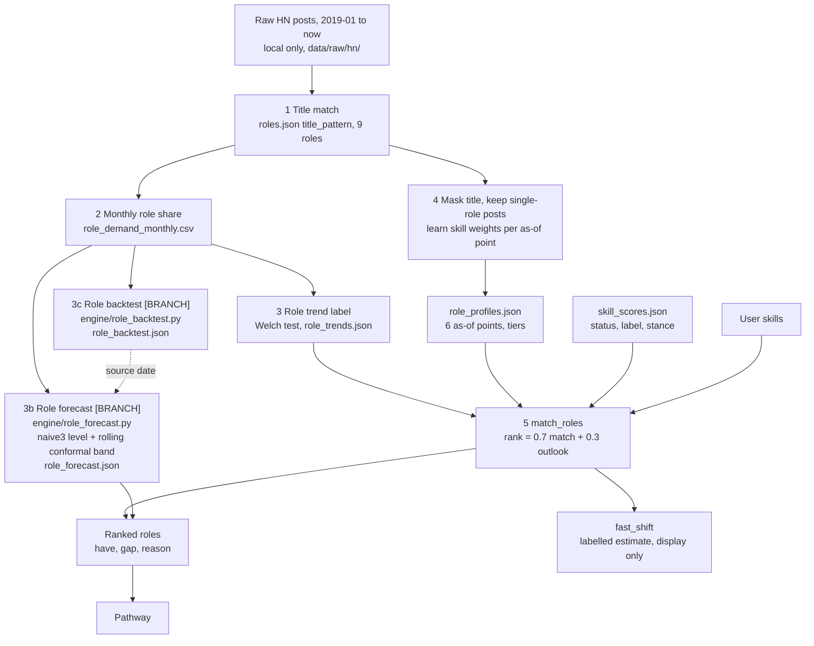

# Role forecast: text for `docs/architecture.md`, section 4

`docs/architecture.md` exists only on branch `docs/architecture`, not in this branch. This file holds the replacement text for sections 4.1, 4.2 and 4.4 (and one line in 4.5). Paste it over those subsections when the two branches meet. Section 4.3 (emerging and declining roles) stays [PLANNED] and is not changed.

Status of the parts: the role level, band and backtest are **[BRANCH]** (branch `feat/role-forecast`, not in `main`). Everything else in 4.2 keeps its tag [LIVE].
Numbers come from `data/role_backtest.json` and `data/role_forecast.json`, made by `python -m engine.role_backtest` and `python -m engine.role_forecast`.

---

### 4.1 What "predict" means here

Verity does not predict the number of jobs. It predicts a role's **share of job posts** in a public sample.

- **Role demand** is the monthly share of HN hiring posts whose text names the role. A title pattern in `data/roles.json` decides the match.
- **The outlook** is the same machinery as for skills: a persistence level (naive3, the mean of the last 3 months on the logit scale), a rolling conformal band and a Welch trend label. Persistence won the skill backtest, so we tested it for roles instead of assuming it (section 4.4).
- **The role's skills** are learned from single-role posts, at as-of points, so a profile never saw posts from after its date.

The trend label and the learned profile are [LIVE]. The role level, band and backtest are built on a branch **[BRANCH]**. Emerging-role discovery is [PLANNED] (section 4.3).

### 4.2 Pipeline [LIVE] plus role forecast [BRANCH]

Steps 1, 2, 4, 5, 6 and 7 are as before (title match, monthly share, learned profiles, rank, fast shift, no leakage). Steps 3, 3b and 3c:

3. **Role trend label.** `build_role_trends` calls `engine.forecast.trend_label` and writes `data/role_trends.json`. It is still the only input to `future_score`, so the rank is unchanged.
3b. **Role forecast [BRANCH].** `engine/role_forecast.py` renames `role_id` to `skill` in `role_demand_monthly.csv` and calls the same functions that score skills: `logit_series`, `forecast_skill` (naive and naive3), `build_residual_tables`, `choose_model`, `band_offsets` (W = 24, one pooled quantile `q`), `volatility`, `has_enough_data` and `trend_label`. No maths is copied; `tests/test_role_forecast.py` checks that the function objects are the same. It forecasts the 8 ranked roles 12 months ahead and writes `data/role_forecast.json`: `share_now` (3 pooled months, m/n), `level_now`, the 12-month value with its 80% target band, `band_width_pp`, the trend label with shares and p, sources and `partial_month`. A role with a mean below 5 mentions a month over the last 12 months is `low_volume`: counts, no band. `role_forecast_for(as_of)` cuts the rows at `as_of`, so the As-of slider never sees a later month. The role card in the app shows one line from these files. Today the chosen model is naive3, q at h=12 is 1.55 on the logit scale, and all 8 roles are `ok` (data/role_forecast.json).
3c. **Role backtest [BRANCH].** `engine/role_backtest.py` runs `engine.backtest.run_backtest` on the same table and writes `data/role_backtest.json` (section 4.4).

What is not built:

- A Fast scenario for the role level or band. The `fast_shift` of `match_roles` stays a labelled estimate.
- Emerging-role discovery (section 4.3).
- A role refresh in the daily job. Role files change only when someone rebuilds them.

### 4.4 How each part is evaluated

**Role backtest [BRANCH].** Same design as skills, run on `data/role_demand_monthly.csv` for the 8 ranked roles. Rolling origins 2021-12 to 2025-10; early 2021-12..2023-10 (23 origins), test 2023-11..2025-10 (24 origins). At every origin only earlier data is used. Nothing was tuned on the test origins.

| Measure (test origins) | Roles (data/role_backtest.json) | Skills (data/backtest.json) |
|---|---|---|
| Role-origin or skill-origin pairs | 188 (8 roles) | 616 (40 skills) |
| MAE at h=12, naive | 1.632 pp | 1.806 pp |
| MAE at h=12, naive3 | 1.604 pp | 1.661 pp |
| naive3 gain over naive at h=12 (95% interval, roles resampled) | 0.028 pp (-0.093 to +0.149) | not compared here |
| Band coverage at h=12 (nominal 80%) | 93.6% | 93.8% |
| Band coverage, mean over h=1..12 | 88.0% | 91.1% |
| Mean band width at h=12 | 8.48 pp | 8.38 pp |
| Trend-label hit rate (Rising or Falling) | 69.3% on n = 228 (77 Rising, 151 Falling) | 67.2% on n = 720 |

How to read it:

- **Point forecast.** naive3 is better than naive on test (1.604 against 1.632 pp), but the gain is 0.03 pp and its 95% interval includes zero. With 8 roles we cannot tell the two apart. The production rule picks naive3 on the data to 2026-10 (1.578 against 1.631 pp). Drift and damped are worse than naive at h=12 on test (1.783 and 1.864 pp) and are not shipped.
- **Band.** At h=12 the band covers 93.6% against a target of 80%, so it is too wide at that horizon (conservative). At h=1 to 3 it covers 79% to 82%, close to target. The mean over h is 88.0%. The rolling quantile is pooled over 8 roles, so one noisy role moves it. The share-group split is thin (41, 111 and 36 role-origins). Widths in pp are not directly comparable between roles and skills, because roles have larger shares.
- **Label.** 69.3% of Rising or Falling labels matched the next 12 months, against 50% for a coin flip. That is similar to the skill rate (67.2%). The role-origins overlap and the roles move together, so n = 228 is far fewer than 228 independent tests. This is a rough guide, not a validation. Falling labels (70.2% on 151) did slightly better than Rising labels (67.5% on 77).
- **Sample.** Only 8 roles, so every rate has a wide interval that this file does not show. The skill backtest has 40 skills and 616 test pairs.

**No-look-ahead rule.** Every step takes an `as_of` and ignores later months. A test scrambles every month after `as_of` and checks that `role_forecast_for` returns the same output (tests/test_role_forecast.py).

**Promotion rule, human-review gate, candidate quality.** Unchanged. They apply to the planned signals in 4.3.

### 4.5 What we will not claim (change one line)

Replace "That the role label is validated. Only the skill label is (data/backtest.json). The role test is [PLANNED]." with:

- **That the role label or band is proven.** The role-label hit rate is 69.3% on 228 overlapping role-origins from 8 roles, and the 80% target band covered 93.6% of held-out 12-month outcomes (data/role_backtest.json). The sample is small. We report it as a rough guide.
