# Role suggestions and personalised pathway: architecture plan

Written 24 Oct 2026. Plan only. No code has changed.

Retired 24 Oct: the Streamlit UI (`app.py`) was replaced by Varity. Role matching and the pathway are now served by the Varity API (`trendsignal/web/roles_api.py`); mentions of Streamlit below are historical.

Related: `docs/varity-status.md` (what is hardcoded today), `docs/job-first-flow-plan.md` (Jobs screen UX), `docs/pathway.md` (the deterministic pathway engine), `docs/architecture.md` (system map).

## 1. The idea, and what this plan changes

**The idea.** Three outputs feed one LLM:

1. The skill profile (CV intake, `GET /api/profile`)
2. The AI trend signals (`GET /api/signals`, skill momentum)
3. The job role prediction (`data/role_forecast.json`)

The LLM ranks job roles from best to worst fit and explains each rank: for example, "fits your current skills" or "pays more in the market". When the user switches route, the Pathway page follows. A second LLM step builds a personalised reskilling pathway from the same three inputs.

**Verdict: the idea is right, with three changes.**

| # | Change | Why |
|---|---|---|
| A | **Code computes the scores, and the LLM re-ranks within limits and chooses the reasons.** The LLM does not produce the numbers from scratch. | An LLM rank is not reproducible: the same CV can rank differently on two calls. It can also invent facts. The repo's rule is "code sets the order and the dates; a language model never changes them" (`docs/architecture.md` §3.9). `engine/roles.py::match_roles` already computes match (0.7) + future (0.3). The LLM adds what code can't do: weighing signals against the user's interests and saying it in one clear line. |
| B | **Code writes the reasons as typed "reason chips"; the LLM only picks 2–3 and writes one summary line.** Every number and skill name in a chip comes from code, with its source. | The LLM never writes a fact, so it can't invent one, and there is almost nothing to verify. Each chip links to its source, which keeps the "every claim shows its source and date" promise in the README. With no API key, code picks the top chips by score and only the summary line is missing. |
| C | **"Earns more money" needs a salary source first.** No salary data exists in the repo today. | The LLM must never guess salaries. Until a dated source is added (§7), salary reasons are switched off, and the UI says "salary data not available yet". |

Today there is also **no `ANTHROPIC_API_KEY`** (`docs/varity-status.md` §4). So the design must work fully without the LLM, and the LLM adds on top. That is change A.

## 2. Where we are today

| Piece | State | File |
|---|---|---|
| Skill profile | Live, saved per browser token. Has an unused `target_role` field. | `backend/signals/intake/models.py::Profile` |
| AI signals and skill momentum | Live | `backend/signals/trendsignal/web/app.py::signals_payload` |
| Role forecast (9 roles, trend, 12-month band) | Built; file only | `engine/role_forecast.py`, `data/role_forecast.json` |
| Role matching (match + future score, have/gap) | Built; now served by the Varity API (`roles_api.py`) | `engine/roles.py::match_roles` |
| Pathway (stages, verified resources, scheduled tasks) | Built; now served by the Varity API (`roles_api.py`) | `engine/pathway.py::build_pathway`, `data/resources.json` |
| LLM client, cost tracking, daily budget gate | Built | `backend/signals/trendsignal/llm.py::LlmGate` |
| Varity Routes / Pathway / Today screens | **Hardcoded** | `frontend/data.js` (`ROUTES`, `PATHWAY`, `TODAY`) |

So most of the engine already exists. What's missing is the **glue** (APIs, ID mapping), the **LLM step**, and the **frontend wiring**.

## 3. Architecture

```mermaid
flowchart LR
    subgraph Inputs
        P["Skill profile<br/>GET /api/profile"]
        S["AI signals<br/>skill momentum"]
        F["Role forecast<br/>role_forecast.json"]
    end

    P --> MAP["Skill ID mapper<br/>intake id → taxonomy name"]
    MAP --> CAND
    S --> PACK
    F --> CAND

    CAND["1. Candidate scorer (code)<br/>engine.roles.match_roles<br/>match 0.7 + future 0.3"] --> PACK["2. Reason chip builder (code)<br/>typed chips, numbers filled in"]
    PACK --> LLM["3. Role advisor (LLM)<br/>re-rank within limits<br/>pick 2–3 chips + 1 summary line"]
    LLM --> VER["4. Verifier (code)<br/>chip IDs, summary text, rank limits"]
    CAND -. "no key / budget / error" .-> OUT
    VER --> OUT["Ranked suggestions<br/>GET /api/roles/suggestions"]

    OUT --> SEL["User picks route<br/>POST /api/profile/target-role"]
    SEL --> PW["5. Pathway builder (code)<br/>engine.pathway.build_pathway"]
    PW --> PLLM["6. Pathway coach (LLM)<br/>order within stage, pick resource,<br/>'why for you' text"]
    PLLM --> PVER["7. Verifier (code)<br/>resource IDs from resources.json only"]
    PW -. fallback .-> POUT
    PVER --> POUT["Pathway + dated tasks<br/>GET /api/pathway"]
    POUT --> UI["Pathway page + Today page"]
```



### 3.1 Components

| # | Component | Kind | Does | Never does |
|---|---|---|---|---|
| 0 | **Skill ID mapper** | Code, new (`backend/signals/advisor/mapping.py`) | Maps intake `skill_id` (`python`) to engine taxonomy names (`Python`). Uses `intake/skill_graph.json` and `data/taxonomy.json`. Returns `unmapped` skills too, so the UI can show them. | Guess a mapping. Unknown means unmapped. |
| 1 | **Candidate scorer** | Code, existing | `match_roles(profile_skills, role_profiles, skill_scores, role_trends, scenario)` → every role with `match_score`, `future_score`, `rank_score`, `have`, `gap`, `outlook`. | — |
| 2 | **Reason chip builder** | Code, new (`backend/signals/advisor/chips.py`) | For each role, builds every reason chip that is true (types in §3.3). Each chip has `id`, `type`, `text` with numbers filled in by code, `strength` (0–1, for the no-LLM pick), `source` and `asOf`. | Pass the raw CV text. Only saved, user-checked skills go in. |
| 3 | **Role advisor** | LLM, new | Takes the chips and the code ranking. Returns JSON: new order, `fitLabel`, 2–3 chosen chip IDs, one `watchOut` chip ID (if any), and a one-sentence `summary` per role. | Write numbers, salaries, or skill names not in that role's chips; add chips or roles. |
| 4 | **Verifier** | Code, new | Validates the LLM JSON (Pydantic). Drops unknown chip IDs. Drops a `summary` that has a digit, a money word, or a skill name not in the role's chips (the chips still show). Enforces the **rank limit**: a role can move at most ±2 places from the code rank, and a `low_match` role (match < 0.20) can never enter the top 3. If too much fails, it uses the code ranking. | — |
| 5 | **Pathway builder** | Code, existing | `build_pathway(target_role, gap, role_gaps, skill_scores, resources, scenario, hours_per_week, start_date)` → stages, steps, verified resources, scheduled tasks. | — |
| 6 | **Pathway coach** | LLM, new | Personalises: orders steps **within a stage**, picks one resource per step from the 1–3 verified options, picks 1–2 "why this step" chips built by code (e.g. "closes gap: Vector databases", "skill rising this week") plus a short `whyForYou` line, and can mark a step "skip: you already show this" when a profile chip supports it. | Add resources, change stages, change dates or minutes. |
| 7 | **Pathway verifier** | Code, new | Resource IDs must exist in `resources.json`. Chip IDs must exist; `whyForYou` follows the summary rules. Skip marks need a profile chip. `schedule_tasks` re-runs on the final order, so code still sets the dates. | — |

### 3.3 Reason chips

| Type | Icon | Built from | Example text (code fills the numbers) |
|---|---|---|---|
| `skill_fit` | 🧩 | Profile vs role skills (`have`) | "You already have 6 of 9 core skills: Python, SQL, Airflow" |
| `small_gap` | 🎯 | `gap` + pathway weeks | "Only 2 skills to learn, about 6 weeks at 5 h/week" |
| `demand_rising` | 📈 | Role forecast trend + band | "Share of job posts rising; 12-month range 4.4%–9.6%" |
| `ai_boost` | ⚡ | Skill momentum for the role's skills | "LLM app dev, a skill in this role, is rising this week" |
| `watch_out` | ⚠️ | Flat/falling forecast, or a key missing skill | "Demand flat over 12 months" |
| `pays_more` | 💰 | Salary source (§7) | Not built until a salary source exists |

A chip is only built when its condition is true (e.g. no `demand_rising` chip for a falling role). Pathway steps use the same pattern with step chips (`closes_gap`, `skill_rising`, `already_shown`).

### 3.2 Why this split (agentic engineering)

- **Code owns facts, numbers and reason text. The LLM owns choosing and one line of wording.** Each LLM call has one job and a strict JSON schema, so it can be tested and checked.
- **Two small LLM calls, not one agent loop.** No tools and no autonomy. That keeps cost, latency and failures easy to predict for a hackathon demo.
- **Fallback at every LLM step.** With no key, an expired budget or a timeout, the user still gets the code ranking and code pathway, labelled "ranked by formula".

## 4. API contract

All responses use the existing envelope `{success, data, error, meta}` (`app.py::envelope`). All profile routes take `X-Profile-Token`, like `cv_api.py`. Names follow the house style (`/api/profile/apply`, `/api/profile/remove`).

### 4.1 `GET /api/roles/suggestions?scenario=moderate`

Needs a saved profile (otherwise 404 `PROFILE_NOT_FOUND`).

```jsonc
{
  "success": true,
  "data": {
    "rankedBy": "llm",                // "llm" | "formula" (fallback)
    "llmStatus": "llm",               // "llm" | "cached" | "off:no_key" | "off:budget" | "off:error"
    "scenario": "moderate",
    "inputs": {                       // what the ranking was built from, for the "as of" line
      "profileUpdatedAt": "2026-10-24T09:12:00+08:00",
      "signalsRunId": "20261022T050908-ab9c76",
      "forecastAsOf": "2026-10"
    },
    "targetRoleId": "ai_llm_app_engineer",   // the user's current route, or null
    "roles": [
      {
        "roleId": "ai_llm_app_engineer",
        "name": "AI/LLM Application Engineer",
        "rank": 1,
        "formulaRank": 2,
        "matchPct": 62,
        "outlook": { "label": "Rising", "shareNow": 0.065, "low": 0.044, "high": 0.096, "asOf": "2026-10" },
        "fitLabel": "Strong fit, rising demand",
        "summary": "Closest to what you already do, and demand is growing.",   // LLM; null when ranked by formula
        "reasons": [                  // 2–3 chips, chosen by the LLM or by strength
          { "id": "c_fit", "type": "skill_fit", "text": "You already have 3 of its 6 core skills: Python, FastAPI, SQL", "source": "profile", "asOf": "2026-10-24" },
          { "id": "c_demand", "type": "demand_rising", "text": "Share of HN hiring posts rose 4.96% → 6.33% in 12 months", "source": "role_forecast", "asOf": "2026-10" }
        ],
        "watchOut": { "id": "c_gap", "type": "watch_out", "text": "No evaluation or guardrail skills in your profile yet", "source": "profile" },
        "have": ["Python", "FastAPI", "SQL"],
        "gap": ["LLM evaluation", "Vector databases", "AI security"],
        "salary": null                // null until a salary source exists (§7)
      }
    ],
    "lowMatch": [ { "roleId": "mobile_developer", "matchPct": 12 } ]
  }
}
```

### 4.2 `POST /api/profile/target-role`

Body `{ "roleId": "ai_llm_app_engineer" }`. Saves `Profile.target_role` (the field already exists). Returns the updated profile. 422 if `roleId` isn't in `roles.json`. Idempotent: setting the same role twice changes nothing.

### 4.3 `GET /api/pathway?roleId=&hoursPerWeek=5&scenario=moderate`

`roleId` defaults to the saved `target_role`. With neither, it returns 409 `NO_TARGET_ROLE`. Returns `build_pathway` output in camelCase, plus `personalisedBy` / `llmStatus`, and per step 1–2 `reasons` chips and a `whyForYou` line. The scheduled `tasks` also feed the Today page.

### 4.4 Errors

| Status | Code | When |
|---|---|---|
| 404 | `PROFILE_NOT_FOUND` | No token, or the token is unknown |
| 409 | `NO_TARGET_ROLE` | Pathway asked for before a route is picked |
| 422 | `VALIDATION_ERROR` | Bad `roleId`, `scenario`, or `hoursPerWeek` outside 1–40 |
| 429 | `RATE_LIMITED` | Existing per-client limiter |

An LLM failure is **never** an HTTP error. It returns 200 with `rankedBy: "formula"`.

## 5. LLM design

### 5.1 Models and cost

| Call | Default model | Why | Max tokens out |
|---|---|---|---|
| Role advisor | `claude-haiku-5-5` (env `VARITY_ADVISOR_MODEL`) | Re-ranking 9 roles from a short pack is a narrow task. Same default as `enrich_model`. | ~1,200 |
| Pathway coach | `claude-haiku-5-5` (env `VARITY_COACH_MODEL`) | Choose and write within fixed options | ~1,500 |

Escalate to `claude-sonnet-5-5` only if the evals (§8) fail with a clear reasoning gap. Both calls go through `LlmGate` (shared daily budget) and record cost in the existing `llm_spent_since` ledger, with new job names `advisor` and `coach` added to `LLM_JOBS`.

### 5.2 Caching

Cache key = `sha256(sorted skill ids + years, signals runId, forecast as_of, scenario, prompt version)`. Store the JSON in the existing SQLite db, in a new table `advisor_cache(key PK, kind, payload, created_at)`. Effects:

- The same inputs never pay twice, and the demo is stable.
- A new signals run or an edited profile changes the key, so the ranking updates "when the data changes", as the README promises.

### 5.3 Prompt rules (both calls)

- The system prompt says: choose only from the given chip IDs, write the summary without numbers or money, return only the JSON schema.
- The pack's user text (skill names and quotes) is wrapped as data, using the same injection guard the CV intake uses (`injection_hint`).
- Temperature 0. Structured output via tool-use JSON schema.

### 5.4 Signals → roles link

Signal momentum is per skill (`config/watchlist.yaml`). The chip builder maps each role's top gap/have skills to their momentum row, so it can build an `ai_boost` chip like "a skill you'd learn for this role is rising this week". Skills without a momentum row are left out, never zero-filled.

## 6. Frontend changes

| Screen | Change |
|---|---|
| CV & routes | Replace `ROUTES` with `GET /api/roles/suggestions`. Show the summary line and 2–3 reason chips (icon + short text); tapping a chip shows its source and date. "Switch to this route" calls `POST /api/profile/target-role`, then goes to `#/pathway`. |
| Pathway | Replace `PATHWAY` with `GET /api/pathway`. The title uses the chosen role's name. The SVG map is drawn from the returned steps (lines = stages or skills), not fixed coordinates. |
| Today | Take today's tasks from the pathway `tasks` (dated by `schedule_tasks`). Ticks are saved on the server: a new `POST /api/progress {taskId, done}` keeps the done set on the profile. |
| All | Badge "Ranked by AI, checked against data" vs "Ranked by formula". Offline (opened as a file), keep the bundled sample, as the Signals page already does. |

## 7. Salary ("earning more money")

There is no salary data in the repo. Options, in order of preference:

| Option | Honest? | Effort |
|---|---|---|
| a. Stated salaries from curated `data/jobs.json` postings (`docs/job-first-flow-plan.md` option a) | Yes: "median of N postings that state a salary, 24 Oct" | Small; comes with the Jobs screen |
| b. A public Malaysian survey (e.g. DOSM Salaries & Wages Survey) mapped to the 9 roles | Yes, but coarse occupation groups | Medium; mapping work |
| c. Let the LLM estimate | **No.** Breaks the "every claim has a source" rule | — |

Until (a) or (b) exists, `salary` is `null`, and the advisor's schema has no salary field, so it can't make a salary claim.

## 8. Evals (define before building)

Use the three intake samples (`intake/samples/aina.txt`, `daniel.txt`, `priya.txt`) plus 2 edge profiles: an empty profile and a profile with only off-taxonomy skills.

| Eval | Pass bar |
|---|---|
| Every shown chip ID exists and every summary passes the text rules | 100% after the verifier; LLM raw ≥ 95% |
| Every chip's text matches its source data (chip builder unit tests) | 100% |
| No money amounts or invented roles or resources in the output | 100% |
| Rank limit holds (±2, no low-match in the top 3) | 100% |
| Same inputs → same output (cache, temp 0) | 100% |
| Fallback: no key → 200 with `rankedBy: "formula"` | 100% |
| Route switch → pathway title and steps match the new role | 100% (E2E) |
| Human check: reasons are true and useful (team rates 1–5) | Mean ≥ 4 |

## 9. Build order (each unit can be checked on its own)

| # | Unit | Done when |
|---|---|---|
| 1 | Make `engine/` importable from the backend (add the verity root to `sys.path` in `trendsignal/web/app.py`, as `app.py` already does) | `from engine import roles` works under `python -m trendsignal serve` |
| 2 | Skill ID mapper + tests | The 3 samples map with listed unmapped skills |
| 3 | `GET /api/roles/suggestions` formula-only (no LLM), with chips picked by strength | API test returns ranked roles with reason chips for a saved profile |
| 4 | `POST /api/profile/target-role` + `GET /api/pathway` formula-only | Route switch changes the pathway in an API test |
| 5 | Frontend: Routes, Pathway, Today wired to the APIs | Hardcoded `ROUTES`/`PATHWAY`/`TODAY` used only offline |
| 6 | Reason chip builder + verifier (tested with fake LLM JSON) | Chips match data; bad chip IDs, bad summaries and rank jumps are dropped in tests |
| 7 | Role advisor LLM call + cache | Evals in §8 pass for the advisor |
| 8 | Pathway coach LLM call | Evals pass for the coach |
| 9 | Server-side tick progress | Ticks survive a refresh |
| 10 | Salary source (option a) | `salary` filled from dated postings |

Units 1–5 already remove every hardcoded item in `docs/varity-status.md` §2 for Routes and Pathway, **with no API key needed**. Units 6–8 add the LLM layer.

## 10. Risks and open decisions

| Risk / decision | Plan |
|---|---|
| `engine/` sits outside the backend package | Unit 1 uses a path insert (smallest). Moving `engine/` into `backend/` comes later, as the README already says. |
| Only 9 roles; the frontend shows names like "LLM application engineer" | Use `roles.json` IDs and names everywhere and drop the frontend role names. |
| Intake skills outside the 40-skill taxonomy don't count toward match | Show them as "not scored yet" so the user knows why. |
| How far the LLM may move a role (±2) | Team judgement. Make it a constant (`MAX_RANK_SHIFT = 2`) and revisit after the human eval. |
| Latency: 2–6 s per LLM call | The cache covers repeat visits. First visit: show the formula ranking at once, then swap in the LLM ranking when it returns (one extra fetch with `?wait=llm`). |
| Cost | Haiku, about 3k tokens per call, cached per input set. The daily cap comes from the existing `llm_daily_budget_usd`. |
| No API key today | Units 1–5 don't need one. Add `ANTHROPIC_API_KEY` to `backend/signals/.env` before unit 7. |
