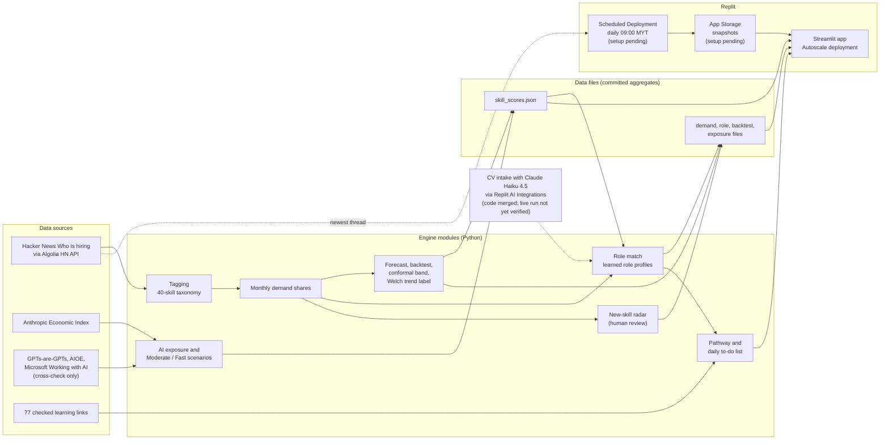

# Phase 1 Preliminary Proposal: Verity

Export to PDF as `SDC2026_HokkienMeeIsPurple_Preliminary.pdf`.
Items marked [TEAM TO FILL] are for the team. Do not submit with any of them left in.

## 1. Team Overview

| Field | Entry |
|---|---|
| Team name | Hokkien Mee Is Purple |
| Selected domain | Domain 1: Aiversecity Future-Ready Workforce |
| Selected SDG track | SDG 4: Quality Education (main)¹ |
| Project name | Verity |
| Team leader | Tay Ee Zhan |
| Leader email | [TEAM TO FILL: leader email] |
| Leader phone | [TEAM TO FILL: leader phone] |
| University | [TEAM TO FILL: university] |
| Number of members | 2 (Tay Ee Zhan, Goh Sheng Kuan) |
| Live prototype | https://verity--eezhan0805.replit.app |
| Code repository | https://github.com/TayEeZhan/verity (public at submission) |

¹ We pick SDG 4 as the main track. Verity's core output is a learning plan that adds job-listed skills. That matches target 4.4 and its indicator 4.4.1 (ICT skills for employment). SDG 8 (targets 8.2 and 8.5) follows only if users then find better work. We cannot measure that in Phase 2.

## 2. Project Description

### 2.1 Problem Context

Aina is a junior Python developer in Malaysia. She is a synthetic example. She hears that AI is changing tech jobs. She cannot tell which skills to deepen, which to drop, and what to learn next.

In Malaysia, 56% of professionals already use AI tools at work, yet only 26% have received formal training (Domain 1 brief, citing Hays Asia Salary Guide 2025). MOSTI has said that more than 600,000 workers will need reskilling within three to five years (Domain 1 brief).

Our user is a junior or mid-level tech developer, or a career switcher, in Malaysia. This user meets three problems.

1. Skill lists carry no date, no source and no measure of doubt.
2. Hype hides the signal. In Hacker News hiring posts, the share that mention AI rose from 6.4% in January 2019 to 54.6% in September 2026. Demand for the LLM / GenAI skill itself showed no clear change: 566 mentions in 3,714 posts in the last 12 months against 561 in 3,914 posts in the 12 before (Welch test, p = 0.207).
3. Free learning resources are scattered. The user cannot tell which ones still work.

Our backtest shows the risk of false confidence. Twelve months ahead, a skill's share of job posts changes little. Simple persistence beat every trend model we tested. Verity gives a tested range, a plain Rising or Falling label, and a dated source on every line. The user decides.

(233/250 words)

### 2.2 Proposed AI Solution

Verity is a decision aid. It forecasts skill demand, ranks roles and builds a learning plan. A person makes every decision. Our AI and machine learning:

- **Statistical forecast.** We model each skill's monthly share of job posts on a logit scale. A rolling-origin backtest over 24 test months chose the model. Production picks between "last month" (naive) and "mean of the last 3 months" (naive3) by backtest. Today it picks naive3, with a 12-month error of 1.66 percentage points. The trend models scored 2.13 and 2.27. A conformal band wraps each forecast. It covered 93.8% of real values against an 80% target.
- **Welch trend test.** A t-test compares the last 12 months with the 12 before and labels each skill Rising, Falling or No clear change. The direction held in 67.2% of 720 backtest cases.
- **Learned role profiles.** We learn skill weights for 9 tech roles (8 with enough posts to rank) from Hacker News posts that name exactly one role.
- **A model that lost.** We trained a gradient-boosting model (HistGradientBoostingRegressor) on all skills. Its error was 2.06 points, worse than 1.66. We did not ship it.
- **CV intake with Claude Haiku 4.5.** The model only points at skills and gives a quote for each. Code drops any skill whose quote is not in the CV, word for word.

Only the CV intake uses a language model. Code, not a model, sets the forecast, the role ranking and the plan order. Two scenarios, Moderate and Fast AI disruption, are labelled as estimates. The user can also enter skills in a form (example profiles plus a skill picker). HRD Corp status is shown as not verified.

The build also uses the workshop topics in general terms: generative AI (CV intake), data handling (stored snapshots) and cloud deployment (Replit).

(297/300 words)

## 3. Technical Approach

### 3.1 Conceptual Tech Stack

- **Language and app:** Python 3.12, Streamlit (five tabs: Roles, Pathway, Skills, Skill detail, Method).
- **Data and statistics:** pandas, NumPy, SciPy (Welch test), statsmodels (damped-trend model, tested only).
- **Machine-learning experiment:** scikit-learn (not used in the app).
- **Data sources:** Hacker News "Ask HN: Who is hiring?" threads through the Algolia HN Search API (free); Anthropic Economic Index (AI exposure); GPTs-are-GPTs, AIOE and Microsoft Working with AI (exposure cross-check only).
- **Hosting:** Replit Autoscale deployment (live). Replit App Storage (data snapshots) and a Replit Scheduled Deployment (daily refresh): code merged; Replit setup pending.
- **Generative AI:** Claude Haiku 4.5 (Anthropic) for CV intake, through Replit AI Integrations (Replit-managed credentials, billed to Replit credits). A direct Anthropic key also works. With no credentials, a keyword pass takes over. Design: not yet verified on the live Replit app.

**Sponsor GenAI API or cloud platform.** We use Replit for hosting. We will use App Storage and Scheduled Deployments once set up (code merged; Replit setup pending). We use Replit AI Integrations for the CV intake (Claude Haiku 4.5), with a cap of $1 per day. We use no GPU, so we use no RunPod.

### 3.2 Design-Thinking & Deployment Strategy

**Empathise.** Our user is Aina, a synthetic junior developer built from the brief. We have not run user interviews yet. [TEAM TO FILL: add real interviews, or delete.]

**Define.** She needs a dated trend, a role match with a skill gap, and an ordered plan with free resources.

**Ideate.** LinkedIn and X break terms or hold personal data. JobStreet blocked plain requests with a bot challenge. We chose Hacker News hiring threads. We tried a machine-learning forecaster and dropped it when it lost.

**Prototype.** A five-tab Streamlit app.

**Test.** Over 700 automated tests and a backtest with no look-ahead. In Phase 2 we will test with the three synthetic personas and [TEAM TO FILL: number] volunteer users.

**Deployment.** The app runs as a Replit Autoscale deployment. The daily refresh job and App Storage snapshots are code merged; Replit setup pending. Once set up, the job will refresh the data at 09:00 Malaysia time and save a snapshot. On failure, the app shows the last good data with its date.

**Hardest risk.** Hacker News is US-heavy. Our fallback: the app says so, and Malaysian sources are future work.

(187/200 words)

## 4. Environmental Impact Preliminary Framework & SDG

Phase 2 impact figures are **targets** for the team to measure in Phase 2 user testing. They are goals, not results.

| Target SDG sub-target | Current problem baseline (with source) | Core measurable KPI (unit) | Phase 2 impact target |
|---|---|---|---|
| **SDG 4.4** "By 2030, substantially increase the number of youth and adults who have relevant skills, including technical and vocational skills, for employment, decent jobs and entrepreneurship." | In Malaysia, only 26% of professionals have received formal training in AI tools (Domain 1 brief, citing Hays Asia Salary Guide 2025) | Test users who finish at least one plan step, using a link-checked learning resource (77 resources, link-checked: HTTP 200 on 22 Oct 2026; 76 free, 1 free trial), within 14 days (% of test users) | Target: 50% of test users |
| **SDG 8.5** "By 2030, achieve full and productive employment and decent work for all women and men, including for young people and persons with disabilities, and equal pay for work of equal value." | MOSTI has said that more than 600,000 workers will need reskilling within three to five years (Domain 1 brief) | Test users who pick a target role after they see the match score and skill gap (% of test users) | Target: 80% of test users |
| **SDG 8.2** "Achieve higher levels of economic productivity through diversification, technological upgrading and innovation, including through a focus on high-value added and labour-intensive sectors." | In Malaysia, 56% of professionals already use AI tools at work (Domain 1 brief, citing Hays Asia Salary Guide 2025) | Test users who add at least one Rising or AI-complement skill to their plan (% of test users) | Target: 60% of test users |

**Sources.**
- Hays Asia Salary Guide 2025 (56% and 26%) and MOSTI (more than 600,000 workers): both as cited in the Domain 1 brief. [TEAM TO FILL: add the full reference and link from the brief.]
- United Nations, Sustainable Development Goals, targets 4.4, 8.2 and 8.5: https://sdgs.un.org/goals.
- Verity KPIs: the app shows plan progress per session (`engine/pathway.py`, `progress()`) but stores no events; we will record all three KPIs in the Phase 2 test session.

**Environmental note.** Verity runs on CPU only. It trains no model in production. The daily refresh job takes about 7 seconds.

## 5. Readiness Eligibility Checklist

The wording below follows our reading of the rules. [TEAM TO FILL: match each line to the official template wording.]

- [ ] All members are foundation, diploma or bachelor students at a Malaysian higher-education institution. [TEAM TO FILL: tick for both members]
- [ ] All members completed the mandatory GenAI, Database and Cloud Deployment workshops. [TEAM TO FILL: tick only if both members completed all three workshops]
- [x] Replit is part of the solution. Proof: live deployment URL https://verity--eezhan0805.replit.app. No GPU work is done, so no RunPod proof is needed (the organisers confirmed this on 22 Oct 2026).
- [x] The repository was created after the build clock started (19 Oct 2026, 8 PM) and carries an Apache 2.0 licence. The first commit is dated 21 Oct 2026, 23:49 (+0800).

## 6. IP Declaration & Originality

### 6.1 Pre-existing work

None. The repository was created on 21 Oct 2026, after the build clock started on 19 Oct 2026. The first commit holds only the Apache 2.0 licence and a one-line README. Every other commit is dated 21 or 22 Oct 2026 (42 commits on `main` on 22 Oct 2026). We wrote all code, data files and documents during the event. We used AI tools to write much of the code from our own prompts. We declare them in the Technical Tools Declaration.

### 6.2 Third-party code, datasets and models

| Name | Type | License |
|---|---|---|
| Streamlit 1.66.1 | Library | Apache-2.0 |
| Pillow 13.0.0 | Library | MIT-CMU |
| pandas 3.0.6 | Library | BSD-3-Clause |
| NumPy 2.5.4 | Library | BSD-3-Clause AND 0BSD AND MIT AND Zlib AND CC0-1.0 |
| requests 2.34.2 | Library | Apache-2.0 |
| statsmodels 0.15.0 | Library | BSD-3-Clause |
| SciPy 1.18.1 | Library | BSD (3-clause) |
| replit-object-storage 1.0.2 | Library | ISC |
| pytest 9.1.1 | Library (tests) | MIT |
| scikit-learn 1.9.1 | Library (experiment only) | BSD-3-Clause |
| joblib 1.6.0 | Library (experiment only) | BSD-3-Clause |
| threadpoolctl 3.7.0 | Library (experiment only) | BSD-3-Clause |
| Altair 6.3.0 (installed with Streamlit, imported by `app.py`) | Library | BSD-3-Clause |
| Hacker News "Ask HN: Who is hiring?" threads, via Algolia HN Search API | Dataset | No licence stated in `data/SOURCES.md`. We commit only aggregate counts and thread links. |
| Anthropic Economic Index, release 2026-06-26 | Dataset | CC BY (data), MIT (code) |
| O*NET 31.0 Database, Task Statements | Dataset | CC BY 4.0 |
| GPTs are GPTs, occupation-level ratings (OpenAI) | Dataset | MIT |
| AIOE (Felten, Raj, Seamans) | Dataset | No licence file. We use it with citation and do not redistribute the files. |
| Microsoft Working with AI, AI applicability scores | Dataset | CC BY 4.0 |
| O*NET-SOC crosswalk tables | Dataset (code mapping only) | O*NET data is mostly CC BY 4.0; the crosswalk pages state no licence of their own |
| HistGradientBoostingRegressor (scikit-learn) | Model (experiment, not deployed) | BSD-3-Clause |
| Claude Haiku 4.5 (`claude-haiku-4-5`), Anthropic, through Replit AI Integrations | Model (CV intake) | Commercial API terms. Replit bills the calls to Replit credits. |
| Chart colour values in `app.py` (from a "dataviz" skill used with Claude Code) | Design values | [TEAM TO FILL: confirm the licence of the palette file] |

Sources: `data/SOURCES.md`, `requirements.txt`, `requirements-dev.txt`, and the installed package metadata.

### 6.3 Other declarations

We use no data from sites that need written permission. We stopped our JobStreet test when the site answered with a bot challenge, and we bypassed nothing. [TEAM TO FILL: permission evidence, if you claim any, and any other declaration the template asks for.]

## 7. Declaration

[TEAM TO FILL: the template declaration wording, then the signature of the team leader, the name, and the date.]

Signature: [TEAM TO FILL]
Name: Tay Ee Zhan
Date: [TEAM TO FILL]
