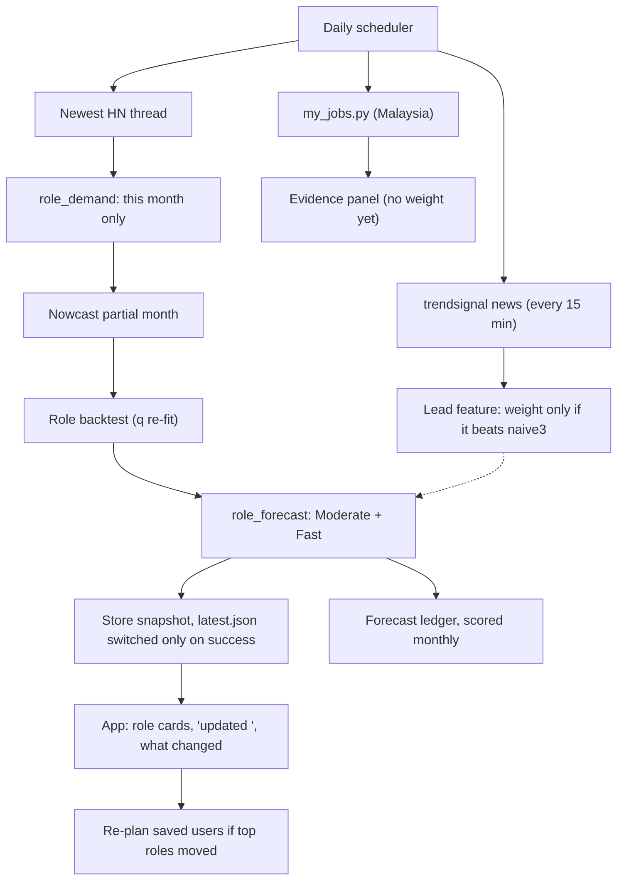

# Plan: a job forecast that updates itself (29 Oct 2026)

Status: DRAFT for your review. Nothing built. Not committed.

Goal: the role forecast ("which jobs grow or shrink") refreshes on its own every day,
says what changed and why, keeps a record of its own past predictions, and gets scored
against what really happened.

---

## 1. Is MiroFish usable here?

**Not as the forecaster. A small, cheap version is usable as an extra signal, if it
earns its place.**

MiroFish (github.com/666ghj/MiroFish) takes documents, builds a knowledge graph in Zep
Cloud, spawns hundreds/thousands of LLM persona agents on a simulated Twitter/Reddit
(OASIS engine), then an LLM "ReportAgent" writes a narrative prediction report.

| Question | MiroFish | Why it matters for Verity |
|---|---|---|
| Output | Narrative report, no numbers | We need a share, a band and a label we can backtest |
| Grounding | Agents' opinions | Finalist rules: "must not invent jobs, courses or statistics"; every claim cites a source |
| Cost | ~$5 per simulation (their own estimate) | A daily run for 9 roles = ~$1,300/month. Our whole pipeline is ~free |
| Reproducible | No (LLM sampling, thousands of agents) | Our "no look-ahead" test and backtest cannot run on it |
| Dependencies | Zep Cloud, OASIS, Flask, OpenAI-compatible LLM | New paid service + new declared tools |
| Licence | **AGPL-3.0** | Serving a modified copy over the web means publishing our whole source under AGPL |

**Mini version that does fit ("persona panel", optional, Phase 6):**
- No simulation, no Zep, no MiroFish code (so no AGPL). One LLM call per day.
- Input: that day's sourced items from `trendsignal` (already collected) + the current
  numbers from `role_forecast.json`.
- 6 fixed personas (Malaysian SME CTO, bank HR lead, TVET advisor, startup founder,
  MNC GBS hiring manager, recruiter) each vote per role: up / flat / down + one cited item.
- Output is a **vote count, never a number we display as a forecast**. Logged daily to
  the ledger (Phase 3). After 6+ months we can score it like any other lead signal and
  only give it weight if it beats naive3 (same promotion rule as `docs/architecture.md`
  §4.3 c). Until then it shows as "What a simulated panel thinks, unverified".
- Cost: ~1 call/day ≈ under $1/month.

That gives the "agents simulating the market" story honestly, without letting an LLM
make up the forecast.

---

## 2. What is weak in the current architecture

From `Predict job architecture.md` / `predict-job.html` and the code:

1. **The role forecast is never refreshed.** `engine/refresh.py` + `engine/scheduled.py`
   rebuild **skills only**. `role_demand_monthly.csv`, `role_backtest.json` and
   `role_forecast.json` change only when someone runs the three commands by hand with
   the raw HN folder on their laptop. Biggest gap, and the main reason it is not "dynamic".
2. **One source, one update per month.** HN posts one thread per month. Even with a
   daily job, the number moves only as that month's thread fills up.
3. **The partial month is flagged, not used well.** `partial_month: true` but the
   share of a thread with 80 posts is treated like one with 400.
4. **The forecast says "same as now".** naive/naive3 means the 12-month estimate ≈
   today's level (see the table: 11.7% → 11.7%). Honest, but it never says anything a
   user can act on. Direction comes only from the trend label.
5. **The band is too wide.** 93.6% coverage against an 80% target. It is pooled over 8
   correlated roles, and `q` is not re-fit as months arrive.
6. **No scenario on roles.** Skills have Moderate / Fast (`scores.fast_scenario`,
   `k_estimate.json`). Roles do not, so must-have #6 is weaker on the role cards.
7. **The forecast does not affect the ranking.** `future_score` is 1 / 0.5 / 0, from
   the label only. A role that is "No clear change" but drifting up scores the same as
   a flat one.
8. **Fixed roles only.** 9 regex titles. Emerging and declining roles (§7 of the doc)
   are not built.
9. **No record of past forecasts.** Nothing proves the forecast works after launch.
   The backtest is from history only.
10. **Malaysia data is empty.** `data/my_roles_snapshots.csv` and
    `data/my_jobs_snapshots.csv` have only the header row. `my_jobs.py` exists but
    has never run on a schedule, so there is no Malaysian history building up.

---

## 3. The plan

Order: each phase works on its own and is useful even if we stop there.

### Phase 1: put roles into the daily refresh (1–2 days) — fixes gaps 1, 5
- In `engine/refresh.py`, after the newest thread is fetched: run `roles.role_demand`
  for **that month only** on the thread JSON already downloaded, and update
  `role_demand_monthly.csv` in the runtime folder (same pattern as skills:
  recompute one month, never touch older months).
- Then call `role_backtest.main(data_dir=...)` and `role_forecast_for(...)` into the
  same runtime folder. Both already take the data from a folder.
- `engine/scheduled.py` already saves the runtime folder to the store and switches
  `latest.json` only on success, so the role files ride along. Add them to the file
  list the store saves, and make `/api/roles/forecast` read from `live.start_dir()`.
- Show on the role screen: "Job forecast updated <fetched_at> · HN thread <month>,
  <n> posts so far".
- Test: run refresh on a fixture thread, check one month changed in
  `role_demand_monthly.csv` and nothing else; check a failed refresh leaves the old
  `role_forecast.json` in use.
- Run it daily (Replit Scheduled Deployment, or one more job in
  `backend/signals/trendsignal/scheduler.py` next to the 15-min pipeline).

### Phase 2: a proper nowcast for the current month (1 day) — fixes gap 3
- Blend the partial month with the last full month, weighted by how many posts exist:
  `y_now = w * y_partial + (1 - w) * y_prev`, `w = n_partial / (n_partial + k)`,
  `k` = median posts per thread (so a half-full thread gets about half weight).
- Put it in `engine/forecast.py` so skills get it too. Backtest it by cutting old
  threads at day 3 / 7 / 14 (post timestamps are in the raw JSON) and checking the error
  is not worse than dropping the partial month.
- Result: the number moves a little every day as posts come in, and the move is
  justified, not noise.

### Phase 3: the forecast ledger (1 day) — fixes gap 9, gives Section 4.1 "proof"
- Every daily run appends one row per role to `forecast_ledger.csv` in the store:
  `run_date, as_of, role_id, share_now, point_12m, low, high, label, model, source_ids`.
- Monthly job: for every ledger row whose target month now has data, fill
  `actual` and `hit_band`. Show on the forecast screen: "Our forecasts from N months
  ago: X of Y landed in the band".
- Also store the day-to-day diff: "Backend Engineer moved from 10.2% to 10.6% since
  yesterday because 41 new posts arrived". `advisor.diff` already compares two
  snapshots; reuse it.

### Phase 4: role scenarios and a continuous outlook (1–2 days) — fixes gaps 4, 6, 7
- Role exposure `e_r` = weighted mean of its skills' exposure, weights from
  `role_profiles.json` (top 10 skills, already normalised) and `exposure.csv`.
- Fast scenario for roles = `scores.fast_scenario(moderate, e_r, k)`, same `k` as
  skills (`k_estimate.json`). No new maths.
- Replace the 1 / 0.5 / 0 `future_score` with the forecast change, clipped:
  `future_score = clip(0.5 + (point_12m - share_now) / scale, 0, 1)` per scenario, so
  switching Moderate ↔ Fast visibly reorders roles. Keep 0.7 / 0.3.
- Re-fit the band each run (it already uses a rolling W = 24 window; just make sure
  Phase 1 re-runs the backtest so `q` follows the data). Report coverage per horizon.

### Phase 5: faster and local sources (2–4 days) — fixes gaps 2, 10
- **Malaysia:** run `engine/my_jobs.py` daily from the same scheduler (it already
  checks robots.txt and rate-limits). After ~8 weeks there is a weekly MY series per
  role. Show it beside HN as "Malaysia, job-board result pages, from <date>".
  It is evidence only until it has 12+ months of history.
- **A second, more frequent posting source with history.** Candidates to check
  (terms, Malaysia coverage, history): Adzuna API, Remotive / RemoteOK public feeds,
  JobStreet / Hiredly result pages (via `my_jobs.py` rules). Pick one that has
  history so it can be backtested; one without history gets the same
  "evidence only" treatment.
- **AI-news momentum as a lead feature:** `trendsignal` already stores dated items
  every 15 min. Aggregate weekly mentions per role/skill and add it to
  `engine/ml_forecast.py` as a feature. It only gets weight if `ml_backtest.py`
  shows it beats naive3 — until there is enough history, it is logged to the ledger
  and forward-tested.

### Phase 6: emerging / declining roles + optional persona panel (3–5 days) — gap 8
- Declining flag first (cheapest): Falling role label AND most of the role's skill
  weight in Falling skills → "declining in this sample". Inputs already exist.
- New titles: extend `engine/discover.py` to "<modifier> engineer/developer/analyst"
  phrases, ≥ 30 posts in 12 months, not matching any `title_pattern`. Goes to a
  review list; a human approves → new `roles.json` entry + test. Stoplist for rejects.
- Persona panel (section 1), logged to the ledger, evidence only.

### Phase 7: re-plan users when the forecast changes (1 day)
- After each daily run, for every saved profile, re-run `match_roles` and compare the
  top 3 with yesterday's. If the order or a band label changed, mark the pathway
  "Updated because <role> moved <x>" with the source and date. This is the finalist
  guide's good-to-have "automatic re-planning when new AI-trend data changes the
  recommendations".

---

## 4. Diagram (what changes)

---

## 5. What else to build or improve next (outside the forecast)

Ranked by value for the effort:

1. **Employer / HR view** — team skills-gap heatmap + one reskilling plan per team.
   Good-to-have #1, reuses `match_roles` per person.
2. **Fairness check** — run the example profiles with name/age/gender changed and
   assert the ranking is identical; publish the test. Cheap and judges ask about it.
3. **Bahasa Malaysia + Chinese UI strings** — the copy is small; LLM-translate once,
   review by a native speaker, store as static JSON.
4. **Forecast ledger page** (Phase 3) doubles as the "measured impact" proof.
5. **HRD Corp-claimable flag** on resources, with the source link per course.
6. **Cost sheet** — per-user and per-month cost of the daily pipeline (data, model
   calls, hosting), now that it actually runs daily.

---

## 6. Not doing

- Running MiroFish itself (AGPL, cost, narrative-only, unverifiable numbers).
- Forecasting job counts. We forecast share of posts; stays that way.
- Auto-adding new roles without a human review.
